# YOUHAN ONE — architecture

**Inspected from the repository on 5 November 2026.**

|              |                                                                                                                                                                        |
| ------------ | ---------------------------------------------------------------------------------------------------------------------------------------------------------------------- |
| Branch       | `claude/ponytail-lite-9d4d9a`                                                                                                                                          |
| Commit       | `1b8226f9069907b6da84e1f868837a2ba9e067e3` (committed 2026-11-04)                                                                                                      |
| Base branch  | `main`                                                                                                                                                                 |
| Written from | the code in this working tree — `prisma/schema.prisma`, `src/app`, `src/lib`, `src/services`, `src/workers`, `infra/`, `.github/workflows`, `apps/mobile`, `apps/face` |

**Repository, not production.** Everything below describes the code in this
commit. This session has no access to the production host, so no runtime claim
here is verified against a live system. Where the repository's own release
record states what production runs, it is quoted and labelled as such:

> `changes/PROJECT.md` (updated 2026-11-04) records production running `main` at
> `4861a72f83e320c00973f654043aa709e84813e1`, released 19 Oct 2026, with
> **126 migrations**, and health re-checked 2026-11-04.

This working tree holds **126** migration folders, so the schema here matches
that count — but whether the running containers are that image was not and
could not be checked from here. Treat the deployment section as _how the
repository says to deploy_, not as a description of a system someone observed.

Editable diagram sources: [`docs/architecture/*.mmd`](architecture/).

---

## 0. In plain English, before any diagrams

YOUHAN ONE is one website that several real-estate companies use at the same
time, each seeing only its own data. A company signs up as a **workspace**, buys
one or more **products** (Sales CRM, People/HRMS, Real Estate, Lead Eagle), and
its staff sign in to work the day:

- An enquiry arrives — from Property Finder, Bayut, Dubizzle, Google Ads, the
  company's own website form, a WhatsApp message or a phone call — and becomes a
  **lead**.
- The system hands that lead to an agent automatically, following rules the
  company wrote (who is on shift, who speaks the language, whose turn it is,
  who has room left in today's quota).
- The agent calls the lead from inside the app. While they talk, the system can
  listen to the call, write the transcript, and whisper coaching suggestions on
  screen. Afterwards it summarises the call, scores it against a quality
  scorecard, and logs the work.
- A manager opens **Daily Activity** each morning and sees, per person, how many
  leads were called, how many answered, how many were interested, and who has
  not started.
- Deals become site visits, bookings, commissions and payouts. HR staff run
  attendance (including face check-in from a phone), leave, shifts and payroll
  in the same place.
- The platform owner has a separate console for creating workspaces, selling
  plans and watching AI spend.

Technically it is **one Node.js application** (`apps/web`) that runs as two
processes from the same code: a **web** process that serves pages and the API,
and a **worker** process that does everything slow or scheduled. They share one
PostgreSQL database and one Redis. Two small extras sit beside it: a Python
service that does the face-recognition maths, and a phone app that is mostly a
window onto the website.

Three sentences a business owner can keep: _one codebase, two processes, one
database._ _Every database query is tagged with the company it belongs to, and
the database itself refuses untagged reads._ _Anything that can be slow — AI,
calling, calendars, emails, imports — happens in the background so a person is
never left waiting._

---

## 1. Project overview

### 1.1 What it does and who uses it

Multi-tenant SaaS for UAE real-estate brokerages and sales teams. One platform
sells four product modules; a workspace sees only the modules it is entitled to
(`src/lib/modules/catalogue.ts`, `PRODUCT_MODULE_KEYS`).

| Module key    | Sold as       | Screens under `src/app/(workspace)/[workspaceSlug]/`                                                                                                                                                                                  |
| ------------- | ------------- | ------------------------------------------------------------------------------------------------------------------------------------------------------------------------------------------------------------------------------------- |
| `SALES`       | Sales CRM     | `sales/` — leads, contacts, accounts, opportunities, tasks, follow-ups, calls and call AI, campaigns, inbox, forms, landing pages, dashboards, leadership, projects, listings, bookings, collections, commissions, proposals, portals |
| `HRMS`        | People / HRMS | `people/` — employees, roles, departments, face check-in, attendance, shifts, roster, leave, overtime, payroll, payslips, WPS, recruitment, performance, documents, compliance                                                        |
| `REAL_ESTATE` | Real Estate   | `realty/` — the brokerage view of the same records, plus properties, the allocation data pool, events with QR passes, lead recycling                                                                                                  |
| `LEAD_EAGLE`  | Lead Eagle    | `lead-eagle/` — lead management without the money and marketing screens; its own sign-in door at `/login?product=lead-eagle`                                                                                                          |

Outside the modules: `check-in` and `attendance` (every workspace, no module
needed), `admin/`, `profile/`, `tasks/`, `notifications/`, and the platform
console in `src/app/(platform)/platform`.

**Roles are not hard-coded.** Roles live in the database per workspace
(`Role`, `Permission`, `RolePermission`, `FieldPermission`). A new workspace gets
one role, _Company Admin_, holding every permission; the admin builds the rest
in the role editor. A workspace with Lead Eagle is also seeded with five
editable starter roles — Manager, Team Lead, Agent, Telecaller, Viewer
(`src/services/platform/provisioning.ts`). So the real "user roles" of the
product are better described as the people who use it:

| Who                       | What they do                                                           | How the code limits them                                                              |
| ------------------------- | ---------------------------------------------------------------------- | ------------------------------------------------------------------------------------- |
| Seller / agent            | works leads, places and logs calls, books visits                       | usually `OWN` scope — their own records                                               |
| Team lead / manager       | reads and reassigns their reporting line's work, reads Daily Activity  | `TEAM` scope = everyone below them on `User.managerId`, every level, plus their teams |
| Branch / regional manager | the same, wider                                                        | `BRANCH`, `REGION`                                                                    |
| Workspace admin           | roles, users, work locations, settings, retention, audit, integrations | `ORGANIZATION` scope + `admin/` screens                                               |
| HR / payroll              | attendance, leave, payroll, documents                                  | HRMS module + `src/services/hr/access.ts` predicates                                  |
| Platform owner / staff    | workspaces, plans, subscriptions, AI Control Center, monitoring grants | `PlatformUser.platformRole`, a second credential, `withPlatformTx`                    |
| Public visitor            | fills a web form, opens a shared listing, RSVPs                        | anonymous routes under `/f`, `/l`, `/s`, `/p`, `/c`, `/li`, `/rsvp`                   |

### 1.2 Technology stack, and why each piece is there

| Component                                                                   | Version in `package.json` | Purpose                                                                                                                                 |
| --------------------------------------------------------------------------- | ------------------------- | --------------------------------------------------------------------------------------------------------------------------------------- |
| Next.js (App Router, Turbopack)                                             | `16.4.2`                  | Serves every screen _and_ the whole API from one app. Pages are server-rendered against the session, so there is no separate SPA build. |
| React                                                                       | `^19.0.0`                 | The interface. Most workspace pages read the database on the server and send HTML.                                                      |
| TypeScript                                                                  | strict                    | One type system across pages, API, services and workers.                                                                                |
| Prisma + `@prisma/adapter-pg`                                               | `^7.10.0` / `^7.0.0`      | Database access and migrations. The adapter is used so the tenant guard can run `set_config` on the same pooled connection.             |
| PostgreSQL                                                                  | via `DATABASE_URL`        | The single source of truth. Row-level security is a second line of defence behind the application's tenant guard.                       |
| Redis + BullMQ                                                              | `^5.4.1` / `^5.34.0`      | Job queues, rate-limit counters, and the pub/sub channel that carries live-call events to the browser.                                  |
| `ws`                                                                        | `^8.21.3`                 | The WebSocket server in the worker that receives forked call audio.                                                                     |
| `@aws-sdk/client-s3`                                                        | `^3.700.0`                | Object storage for recordings, project and listing media, and exports. MinIO locally, any S3-compatible store in a deployment.          |
| `@node-rs/argon2`                                                           | `^2.0.2`                  | Password hashing.                                                                                                                       |
| `zod`                                                                       | `^3.24.1`                 | Every request body, query and param is parsed before a handler runs.                                                                    |
| `nodemailer`                                                                | `^10.3.1`                 | Outbound email (resets, digests, scheduled reports, templates).                                                                         |
| `pino`                                                                      | `^9.5.0`                  | Structured logs, with a request id on every response.                                                                                   |
| `read-excel-file`, `qrcode`, `leaflet`                                      |                           | Spreadsheet import, QR passes, maps. CSV and XLSX **export** are hand-written (`src/lib/csv.ts`, `src/lib/xlsx.ts`) with no dependency. |
| Vitest + Playwright                                                         |                           | Unit/integration and browser tests.                                                                                                     |
| Python + FastAPI + ONNX (`apps/face`)                                       |                           | Face detection, embedding, pose and image quality. Policy stays in TypeScript; this service only does the maths.                        |
| Capacitor                                                                   | `^8.5.0` (`apps/mobile`)  | iOS and Android shells that load the website in a WebView.                                                                              |
| Docker Compose, Caddy, Prometheus, Alertmanager, Grafana (`apps/web/infra`) |                           | Runtime, TLS, metrics, alerts, dashboards.                                                                                              |

Node 22 or newer; CI runs Node 24.

**Scale of the codebase, counted in this commit:** 231 Prisma models,
126 migrations, 257 API route files, 249 pages, 11 Redis queues,
47 `ENABLE ROW LEVEL SECURITY` statements across the migrations.

---

## 2. Architecture diagrams

### 2.1 The whole system

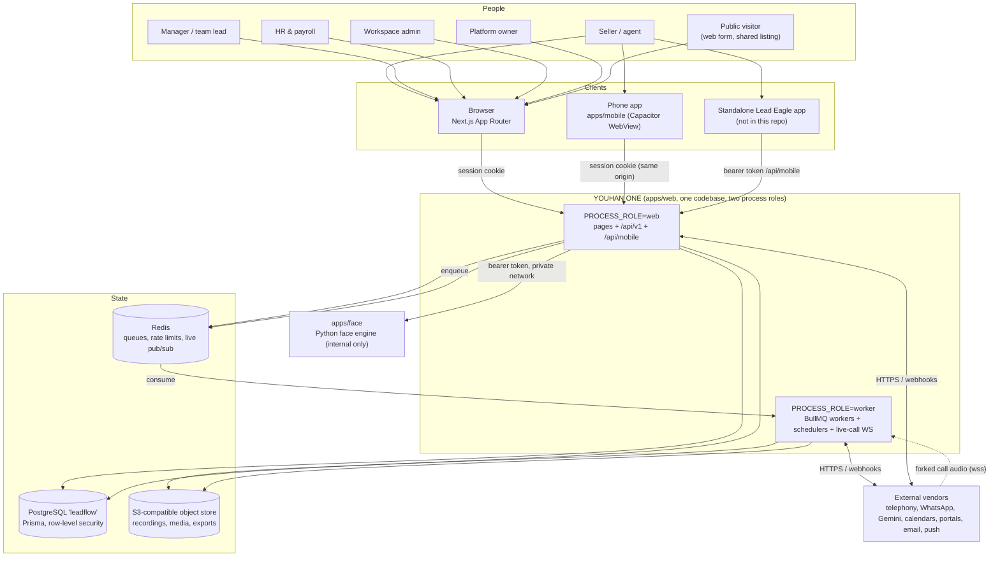

_Source: [`docs/architecture/01-system-overview.mmd`](architecture/01-system-overview.mmd)_

**Reading it.** Everyone reaches the same Next.js application. The browser and
the Capacitor shell both authenticate with a first-party session cookie; the
standalone Lead Eagle phone app is the only client that uses a bearer token, and
it may only call `/api/mobile/**`. The web process never does slow work itself:
it writes to Postgres and _enqueues_ onto Redis, and the worker process picks the
job up. The worker is also the only process that holds a WebSocket server, which
is why live call coaching lives there and not in a route handler. The Python face
engine is never exposed publicly — the web process calls it over the internal
network with a bearer token.

### 2.2 Frontend

```mermaid
flowchart TB
  subgraph groups["src/app — route groups"]
    auth["(auth)<br/>/login, /reset-password,<br/>/service-login"]
    ws["(workspace)/[workspaceSlug]<br/>sales, realty, lead-eagle,<br/>people, admin, profile,<br/>check-in, attendance, tasks"]
    plat["(platform)/platform<br/>workspaces, plans, subscriptions,<br/>AI Control Center"]
    mon["(monitoring)<br/>read-only CRM monitoring"]
    pub["Public: /f /l /s /p /c /li<br/>/rsvp /testimonial /privacy"]
    api["api/<br/>v1/**, mobile/**, health, metrics"]
  end

  gate["resolveWorkspacePage(slug, &#123;module, permission&#125;)<br/>src/lib/workspace-page.ts"]
  nav["workspaceNav.ts<br/>sections → areas → tabs,<br/>each with permission + module"]
  notinplan["NotInPlan<br/>offers the same screen under<br/>a product the plan has"]
  grid["ConfigurableGrid<br/>columns, saved views, keyset paging,<br/>workspace clock"]
  outbox["src/lib/offline.ts<br/>per-owner outbox, Web Lock,<br/>one Idempotency-Key per change"]
  csp["src/proxy.ts<br/>per-request CSP"]

  ws --> gate
  gate -->|"module missing"| notinplan
  ws --> nav
  ws --> grid
  ws --> outbox
  outbox -->|"replayed POST/PATCH"| api
  auth --> api
  pub --> api
  csp --> groups
```

_Source: [`docs/architecture/02-frontend.mmd`](architecture/02-frontend.mmd)_

**Reading it.** Next.js route groups do the structural work. `(workspace)` holds
everything a company's staff use; `(platform)` is the owner's console;
`(monitoring)` is read-only cross-workspace monitoring; `(auth)` is the sign-in
doors; the bare single-letter folders (`/f`, `/l`, `/s`, `/p`, `/c`, `/li`) are
public links — a hosted form, a landing page, a shared listing, a proposal, a
portal, a listing page.

Three rules make the frontend trustworthy rather than merely tidy:

1. **A page asserts its own entitlement.** `resolveWorkspacePage(slug, { module, permission })`
   (`src/lib/workspace-page.ts`). A module layout is not enough, because Next
   still renders the page beneath a `NotInPlan` boundary — so
   `tests/permission/page-access.spec.ts` gates that every page in a module
   folder asserts the module itself.
2. **Hiding a link is not authorisation.** `src/lib/nav/workspaceNav.ts` carries
   a permission and a module on every tab, but the route refuses independently.
3. **One screen, one record.** `realty/` and `lead-eagle/` pages are one-line
   re-exports of `sales/` pages, guarded by
   `tests/unit/realty-routes.spec.ts` and `lead-eagle-routes.spec.ts`. There is
   no second `Lead` model for Real Estate.

Lists go through `ConfigurableGrid` (columns, per-user saved views, keyset
paging, dates on the workspace's clock). Writes made with no connection queue in
`src/lib/offline.ts`: one outbox per `tenantId:userId`, serialised by a Web Lock,
each change carrying its own `Idempotency-Key` so a repeated send is replayed
rather than doubled.

### 2.3 Backend — the life of one request

```mermaid
sequenceDiagram
  autonumber
  participant C as Client
  participant R as route() — src/lib/api/handler.ts
  participant S as Session + RBAC
  participant SV as Service layer (src/services/**)
  participant DB as Postgres (withTx, RLS)
  participant Q as Redis / BullMQ
  participant A as AuditLog

  C->>R: POST /api/v1/leads (JSON, Idempotency-Key?)
  R->>R: origin check, rate limit, zod parse (422 on failure)
  R->>R: Idempotency-Key seen in last 24h? → replay with Idempotent-Replay: true
  R->>S: loadSession(cookie | mobile bearer | API key)
  S-->>R: Ctx &#123;tenantId, actor, scopes, modules&#125;
  R->>R: assert productModule entitlement (403 "… is not enabled for this company.")
  R->>R: atLeast(ctx, module, action, scope) (403)
  R->>SV: handler(&#123;ctx, params, query, body&#125;)
  SV->>DB: withTx(tenantId, tx => …) — set_config('app.tenant_id')
  DB-->>SV: rows this tenant and scope may see
  SV->>Q: enqueue follow-on work (distribution, automation, sla, calendar)
  SV-->>R: result
  R->>A: auditEvent row (actor, object, before/after)
  R-->>C: JSON + x-request-id
  Note over R,C: P2002 → 409, P2025 → 404, zod → 422,<br/>record out of scope → 404 (same as missing)
```

_Source: [`docs/architecture/03-backend-request.mmd`](architecture/03-backend-request.mmd)_

**Reading it.** Every API route is built by `route()` (or `bareRoute()` for the
handful that run before a session exists) in `src/lib/api/handler.ts`. The
kernel, not the handler, does: origin checking, rate limiting, zod parsing,
idempotency replay, session loading, module entitlement, permission and scope
checks, audit writing, and error translation. A handler therefore contains
business logic only.

Error translation is deliberately database-first: Prisma `P2002` becomes **409**,
`P2025` becomes **404**, a zod failure becomes **422** — the code does not read a
row first to produce a nicer message. A record loaded by id that the caller
cannot see answers **404**, exactly as a missing id does, so an id cannot be
probed for existence.

`route()` keeps its schema on the handler, and `GET /api/v1/openapi.json` builds
an OpenAPI 3.1 document from them (`src/lib/api/openapi.ts`), kept equal to the
routes by `tests/unit/openapi.spec.ts`.

`route()` options that shape behaviour: `module`, `productModule`, `action`,
`params`/`query`/`body`, `auditEvent`, `rateLimit`, `anonymous`, `selfService`,
`sessionOnly`, `sensitive`, `idempotent: false`, `mobile: true`.

### 2.4 Background processing

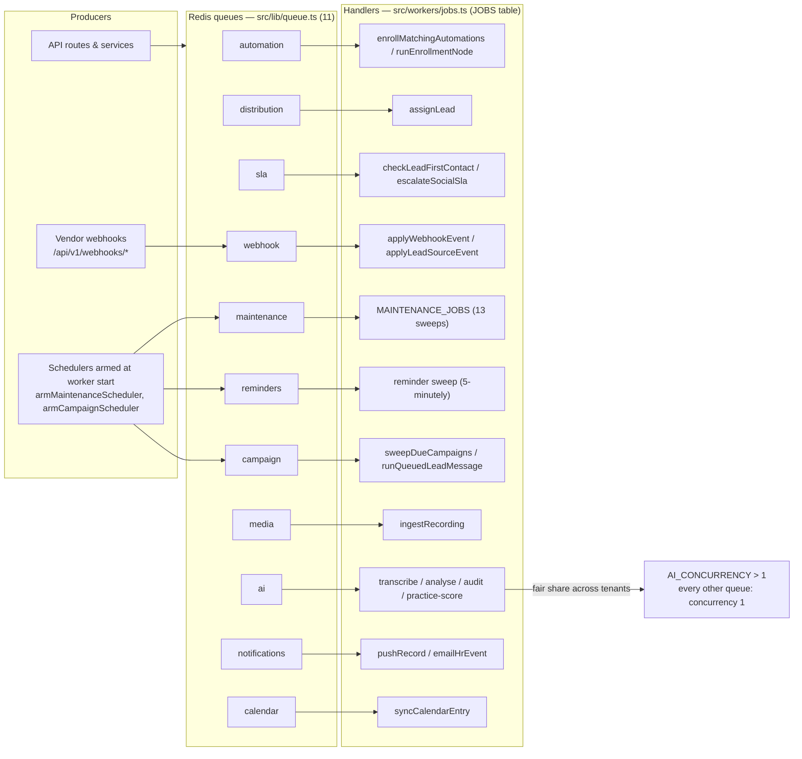

_Source: [`docs/architecture/04-background-jobs.mmd`](architecture/04-background-jobs.mmd)_

**Reading it.** `src/lib/queue.ts` names the 11 queues; `src/workers/jobs.ts`
holds one `JOBS` table keyed by queue name, typed as `Record<QueueName, Jobs>` so
a queue nobody drains — or a consumer for a queue that no longer exists — is a
**compile error**, not a silent backlog. `src/workers/index.ts` starts one worker
per queue, waits for each to actually attach to Redis (10 s limit), and exits
non-zero if any cannot, so a worker that can consume nothing crash-loops visibly
instead of sitting "up" and idle.

Every queue runs one job at a time except `ai`, which runs `AI_CONCURRENCY` jobs
through a fair-share wrapper so one busy workspace cannot starve the others.

Schedules are armed by the worker at start-up, idempotently, from one list
(`armMaintenanceScheduler`, `src/workers/maintenance.ts`):

| Schedule id                           | Pattern      | Job                                                                        |
| ------------------------------------- | ------------ | -------------------------------------------------------------------------- |
| `retention-daily`                     | daily        | `retention` — the data-retention sweep (never a dry run)                   |
| `lead-triage-five-minutely`           | `*/5`        | `triage-sweep` — stale entries, deadlines, notices, then delivery          |
| `first-contact-five-minutely`         | `*/5`        | `first-contact` — uncontacted leads escalated/reassigned                   |
| `automation-time-five-minutely`       | `*/5`        | `automation-time` — time-delayed automation triggers                       |
| `follow-up-drift-daily`               | `20 3 * * *` | `follow-up-drift` — a report-only canary, deliberately with no auto-repair |
| `account-deletions-quarter-hourly`    | `*/15`       | `account-deletions` — erasure of accounts whose owner asked                |
| `lead-recycle-daily`                  | `10 4 * * *` | `lead-recycle` — unworked leads back to the pool                           |
| `lead-score-decay-daily`              | `40 3 * * *` | `lead-score-decay`                                                         |
| `morning-digest-hourly`               | `5 * * * *`  | `digest` — 08:00 on each workspace's clock, so it must run hourly          |
| `report-schedules-quarter-hourly`     | `*/15`       | `report-schedules` — scheduled report emails at 07:00 local                |
| `calendar-sync-retry-quarter-hourly`  | `*/15`       | `calendar-sync-retry`                                                      |
| `reminders-five-minutely` (own queue) | `*/5`        | `sweep` — rings 10–15 minutes before a follow-up is due                    |

The reminder sweep sits on its own queue on purpose: the maintenance worker runs
one job at a time and the digest, retention and report sweeps all do long work
inline, so a reminder queued behind one of them would ring late or not at all.

One subtlety worth knowing before touching jobs: a BullMQ job id is a hash of its
payload and BullMQ ignores an `add` whose id it already holds. Work that must run
again for the same record — every `record.updated` automation trigger, a repeat
SLA warning, a re-sync — must pass `{ fresh: true }`
(`tests/unit/automation-trigger-fresh.spec.ts`).

### 2.5 Mobile apps

```mermaid
flowchart TB
  subgraph shell["apps/mobile — Capacitor 8 shell (in this repo)"]
    wv["WebView → MOBILE_SERVER_URL (https origin only)"]
    cw["CallWatchPlugin.java<br/>logs a call placed from the app"]
    bridge["YouhanBridgeViewController.swift"]
    push["@capacitor/push-notifications"]
  end

  subgraph standalone["Standalone Lead Eagle app (Expo) — NOT in this repo"]
    exp["Native screens"]
  end

  subgraph server["apps/web"]
    pages["Server-rendered workspace pages<br/>(session cookie, first-party)"]
    mapi["/api/mobile/** — route(&#123;mobile: true&#125;)<br/>bearer &#123;tenantId&#125;.&#123;secret&#125;, 90-day MOBILE PlatformSession"]
    fcm["src/lib/push/send.ts → FCM / APNs"]
  end

  wv -->|"renders the site"| pages
  cw -->|"POST leads/&#123;id&#125;/call"| mapi
  push -->|"token + bundleId"| mapi
  exp -->|"sign-in, me, leads, follow-ups,<br/>leads/&#123;id&#125;/call, status, attendance, devices/push"| mapi
  fcm -->|"only while the device session lives"| shell
  fcm --> standalone
```

_Source: [`docs/architecture/08-mobile.mmd`](architecture/08-mobile.mmd)_

**Reading it.** `apps/mobile` is a Capacitor 8 shell whose WebView loads
`MOBILE_SERVER_URL` — an HTTPS origin only, validated at sync time, with no path,
query or credentials. There is no bundled copy of the site and there cannot be
one: `apps/web` builds with `output: 'standalone'` and renders screens on the
server against a session cookie, so nothing can be exported to static files.
Because the WebView loads the application's own origin, the session cookie stays
first-party and no mobile token layer is invented. **A web change therefore needs
no new store build**; only a native change does.

Native code in the repo: `CallWatchPlugin.java` (an outbound call placed from the
app logs itself — start, talk time, Connected or No answer), `MainActivity.java`,
`YouhanBridgeViewController.swift`, and `@capacitor/push-notifications`.

The second phone app — the standalone Lead Eagle Expo app — is **not in this
repository**; only its server side is. `/api/mobile/**` (12 route files) is built
with `route({ mobile: true })` and accepts a 90-day bearer `{tenantId}.{secret}`
on a `MOBILE` `PlatformSession` pinned to one workspace, and nothing else: the
cookie path never accepts it and refresh never issues it. Any revocation of a
person's sessions ends their phones, and a push token is only used while its
device session lives.

> **Verified limitation, stated in the code.** `apps/mobile/capacitor.config.js`
> says in its own header that `server.url` is a _development proof of concept_
> and quotes Capacitor's own documentation that it "is not intended for use in
> production". Builds from that file are labelled as such and, by that comment,
> must not be submitted to a store until a production-supported architecture is
> chosen. `docs/CURRENT_STATUS.md` nonetheless records an iOS 1.2.0 submission
> _Waiting for Review_ — these two statements are in tension, and this document
> does not resolve which is current. See §7.

### 2.6 Data and tenant isolation

```mermaid
flowchart TB
  req["Request with a session"]
  ctx["Ctx &#123;tenantId, actor, scopes&#125;"]
  guard["src/lib/db.ts tenant guard<br/>a query without its tenant is refused"]
  tx["withTx(tenantId)<br/>SELECT set_config('app.tenant_id', …, true)"]
  rls["Postgres row-level security<br/>policies on tenant-owned tables"]
  rows[("Rows of this tenant only")]
  scope["Scope filter — OWN &lt; TEAM &lt; BRANCH &lt; REGION &lt; ORGANIZATION<br/>resolveOwnerIds, leadScope, callScope, attendanceScope"]
  visible[("Rows this person may see")]
  field["applyFieldSecurity / asLeadPhone / maskCallNumbers<br/>dialable() refuses a mask"]
  out["Response"]

  plat["withPlatformTx<br/>set_config('app.platform_admin','on')"]
  platrows[("Cross-tenant reads<br/>platform console only")]

  req --> ctx --> guard --> tx --> rls --> rows --> scope --> visible --> field --> out
  ctx -. "platform console" .-> plat --> platrows
```

_Source: [`docs/architecture/07-tenancy.mmd`](architecture/07-tenancy.mmd)_

**Reading it.** Isolation is enforced four times over, and all four matter:

1. **The application refuses an untagged query.** `src/lib/db.ts` throws
   `TenantGuardError` for a query that does not name its tenant. A read that must
   legitimately span tenants goes through `withPlatformTx` and nothing else.
2. **The database enforces it too.** `withTx(tenantId, …)` runs
   `SELECT set_config('app.tenant_id', …, true)` — transaction-local, so the
   value cannot leak to the next user of the pooled connection — and Postgres
   row-level security policies filter on it.
3. **Scope narrows further, by person.** `OWN < TEAM < BRANCH < REGION <
ORGANIZATION`, checked with `atLeast(ctx, module, action, scope)`
   (`src/lib/security/rbac.ts`) and `assertRecordInScope`
   (`src/lib/security/record-scope.ts`). TEAM/BRANCH/REGION mean the caller's
   _resolved owners_ (`resolveOwnerIds`), never the whole workspace. Specialised
   scopes exist where a record's owner is not its assignee: `leadScope`,
   `callScope`, `eventListScope`, `attendanceScope`, `coldDataScope`,
   `workListScope`.
4. **Fields are masked last.** A lead's phone numbers and email are masked for a
   role without `leads:VIEW_SENSITIVE_FIELDS`; every serialisation goes through
   `applyFieldSecurity`, `asLeadPhone` or `maskCallNumbers`, and `tel:`/`wa.me`
   links are built with `dialable()`, which refuses a mask.

The trap documented in `changes/PROJECT.md` and worth repeating: **inside
`withTx`, query only through its `tx`.** The global client there runs on a
different connection with no tenant set, where row-level security returns
nothing — so a permission or field-rule read that way silently reads as "no
rule". Outside `withTx` each query is its own transaction on its own pooled
connection and the pool holds 10, so a page reading many lists must batch them
into one `withTx(tenantId, tx => Promise.all([...]))`.

#### Core identity and permission entities

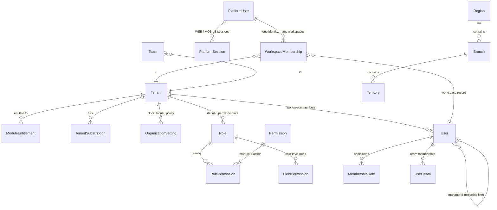

_Source: [`docs/architecture/05-data-core.mmd`](architecture/05-data-core.mmd)_

**Reading it.** An identity (`PlatformUser`) is platform-wide and holds the
credentials; a `User` is that person _inside one workspace_;
`WorkspaceMembership` joins them. That is why password reset needs no workspace
slug (§4.2) and why one person can hold two workspaces. `Role` and `Permission`
are per workspace, so two companies' "Manager" roles are unrelated rows.
`User.managerId` is the reporting line that TEAM scope walks, at every level.

#### The lead and its orbit

```mermaid
erDiagram
  Lead ||--o{ LeadPhone : "numbers (masked without VIEW_SENSITIVE_FIELDS)"
  Lead ||--o{ Activity : "calls, notes, messages"
  Lead ||--o{ Task : "work items"
  Lead ||--o{ FollowUpTask : "next contact"
  Lead ||--o{ Call : "logged + provider calls"
  Lead ||--o{ LeadStageHistory : "stage moves"
  Lead ||--o{ LeadAssignmentHistory : "hand-overs"
  Lead ||--o{ LeadScoreHistory : "score events"
  Lead ||--o{ LeadCustomFieldValue : "workspace fields"
  Lead ||--o{ LeadProject : "interest in projects"
  Lead ||--o{ LeadListing : "interest in listings"
  Lead ||--o{ ClientRequirement : "what they want"
  Lead ||--o{ SiteVisit : "visits"
  Lead ||--o{ Booking : "booked unit"
  Lead }o--|| LeadStage : "current stage"
  Lead }o--|| LeadSource : "where it came from"
  Lead }o--o| User : "ownerId / secondaryOwnerId"
  Call ||--o| Recording : "stored media"
  Call ||--o| RecordingConsent : "consent on file"
  Call ||--o| Transcript : "speech to text"
  Call ||--o| AIAnalysis : "summary, temperature"
  Call ||--o{ CallAudit : "scored against a scorecard"
  Project ||--o{ UnitPlan : "unit types"
  Project ||--o{ UnitInventory : "units"
  Project ||--o{ PaymentPlan : plans
  Listing }o--|| Owner : "landlord"
  Booking ||--o{ Commission : "earned"
  Commission ||--o{ Payout : paid
  DataRecord ||--o{ Activity : "cold-call work"
```

_Source: [`docs/architecture/06-data-lead.mmd`](architecture/06-data-lead.mmd)_

**Reading it.** `Lead` is the centre of the product and deliberately the _only_
lead model — Sales, Real Estate and Lead Eagle all read these rows. Note
`secondaryOwnerId`: a lead's second owner reaches it exactly as its owner does.
A `Call` accumulates a `Recording`, a `RecordingConsent`, a `Transcript`, an
`AIAnalysis` and any number of `CallAudit`s — which is what makes the call
pipeline in §4.3 resumable: each stage is a separate row that either exists or
does not. `DataRecord` is cold-calling data that has not become a lead yet; work
logged against it counts towards the daily target and, when it becomes a lead,
those calls move onto the lead.

Storage: files are refused on size _before_ being read (`readUpload`), recognised
by their bytes, scanned (`assertClean(await scanBuffer(...))` — ClamAV), stored,
and only then recorded; a failed row deletes the object. Project and listing
media live under `inventory/t-{tenant}/` (`mediaPrefix`).

### 2.7 External services

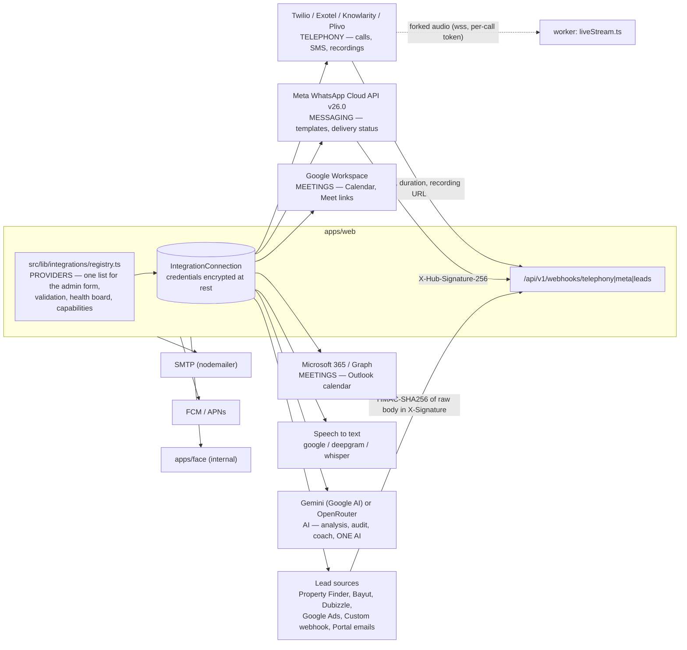

_Source: [`docs/architecture/09-external-services.mmd`](architecture/09-external-services.mmd)_

**Reading it.** Every connectable vendor is one entry in
`src/lib/integrations/registry.ts`. The admin form, the API validation, the
health board and the capability matrix all read that single list, so adding a
vendor is an adapter plus an entry — never a second list to keep in step.
Credentials are encrypted at rest on `IntegrationConnection` and never returned
by any API; operational settings live in readable `metadata`.

| Category        | Providers in the registry                                                              | Capabilities                                           | Inbound webhook                    |
| --------------- | -------------------------------------------------------------------------------------- | ------------------------------------------------------ | ---------------------------------- |
| `TELEPHONY`     | Twilio, Exotel, Knowlarity, Plivo                                                      | calls, SMS where the vendor has it, recordings         | `/api/v1/webhooks/telephony/{key}` |
| `MESSAGING`     | Meta WhatsApp Cloud API (Graph v26.0)                                                  | `TEMPLATE_MESSAGE`, `DELIVERY_STATUS`                  | `/api/v1/webhooks/meta/{key}`      |
| `MEETINGS`      | Google Workspace, Microsoft 365                                                        | create/update/cancel meeting, Meet link, calendar sync | — (OAuth, outbound)                |
| `TRANSCRIPTION` | google, deepgram or self-hosted whisper                                                | `TRANSCRIBE`                                           | —                                  |
| `AI`            | Gemini via Google AI, or OpenRouter                                                    | `ANALYSE`, `AUDIT`, `COACH`, `DRAFT`                   | —                                  |
| `LEADS`         | Property Finder, Bayut, Dubizzle, Google Ads lead forms, Custom webhook, Portal emails | `LEADS`                                                | `/api/v1/webhooks/leads/{key}`     |

Two security details the registry itself records. Exotel and Knowlarity **cannot
sign their callbacks**, so the secret in the URL is the only credential — the
registry marks them `unsignedCallbacks` and the UI says so rather than burying it
in a doc. The Custom webhook and Portal emails sources **issue their own signing
secret** on connecting, shown once, because there is no vendor console to copy
one from; they verify HMAC-SHA256 of the raw body in `X-Signature`.

Without a Gemini key, AI features run in **clearly-labelled simulation**
(`src/lib/ai/simulated.ts`) rather than failing — which is why a green
connection card is not by itself proof that AI works, a point §7 returns to.

### 2.8 Runtime and deployment shape

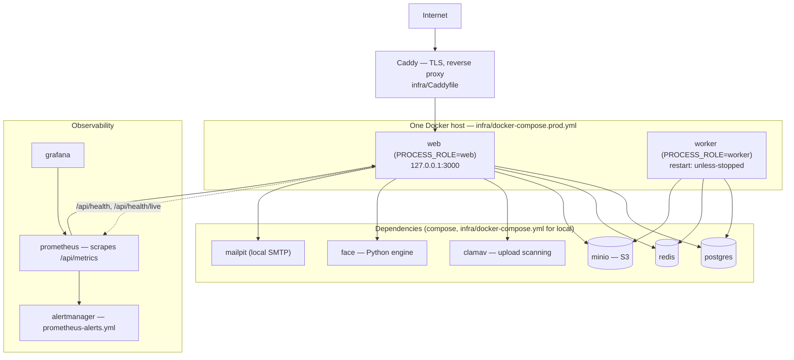

_Source: [`docs/architecture/16-runtime-deployment.mmd`](architecture/16-runtime-deployment.mmd)_

**Reading it.** `infra/docker-compose.prod.yml` defines exactly two services —
`web` (`PROCESS_ROLE=web`, bound to `127.0.0.1:3000`) and `worker`
(`PROCESS_ROLE=worker`) — from two stages of one Dockerfile. Caddy terminates
TLS in front. Postgres, Redis, MinIO, ClamAV, the face engine, Mailpit,
Prometheus, Alertmanager and Grafana are defined in `infra/docker-compose.yml`
for local development; a deployment supplies them (the compose variants
`azure`, `staging`, `small-host`, `pgbouncer`, `staging-gate` exist for different
hosts). Prometheus scrapes `/api/metrics`; `/api/health` reports database and
Redis as `up`/`down` with a 2-second ceiling each, and `/api/health/live` is the
bare liveness probe.

---

## 3. Features and functions

This section maps implemented features to the code. **Status is read from
repository evidence only** — a route and its page exist, a test names it, or a
`changes/` entry records it. "Needs credentials" means the code is present and
the integration is unreachable without a secret the repository does not hold.

### 3.1 Feature-to-component map

| Feature                                                                                             | Screens                                                             | API                                                                            | Services / libs                                                         | Main entities                                                                                  | Permission                                 | Status                                                                                                          |
| --------------------------------------------------------------------------------------------------- | ------------------------------------------------------------------- | ------------------------------------------------------------------------------ | ----------------------------------------------------------------------- | ---------------------------------------------------------------------------------------------- | ------------------------------------------ | --------------------------------------------------------------------------------------------------------------- |
| Leads: grid, board, saved views, export                                                             | `sales/leads`, re-exported in `realty/`, `lead-eagle/`              | `/api/v1/leads/**`                                                             | `services/leads/leadList.ts`, `createLead.ts`, `lib/leads/*`            | `Lead`, `LeadPhone`, `LeadStage`, `SmartView`                                                  | `leads:VIEW/EDIT`, `VIEW_SENSITIVE_FIELDS` | Complete                                                                                                        |
| Lead import (dry run, update-matched, refused rows as CSV)                                          | `sales/leads/import`                                                | `/api/v1/leads/import`                                                         | `read-excel-file`, `services/leads`                                     | `ImportJob`, `Lead`                                                                            | `leads:CREATE`                             | Complete                                                                                                        |
| Lead merge                                                                                          | `/leads/{id}/merge?with=`                                           | `/api/v1/leads/**`                                                             | `services/leads`                                                        | `Lead`                                                                                         | `leads:EDIT`                               | Complete                                                                                                        |
| Lead scoring and decay                                                                              | Admin → Lead Scoring                                                | `/api/v1/lead-scoring`                                                         | `services/leads/scoring.ts`                                             | `LeadScoreHistory`, `ScoringRule`                                                              | `leads`                                    | Complete; decay off unless a `DECAY` rule is set                                                                |
| Cold Data                                                                                           | `sales/cold-data`                                                   | `/api/v1/cold-data`                                                            | `services/leads/coldData.ts`                                            | `DataRecord`, `Activity`                                                                       | `coldDataScope`                            | Complete                                                                                                        |
| Automatic assignment / allocation                                                                   | Allocation → Automatic assignment                                   | `/api/v1/allocation`, `/api/v1/distribution-rules`                             | `services/distribution/assignLead.ts`, `eligibility.ts`                 | `DistributionRule`, `AllocationRequest`                                                        | `distribution:MANAGE_CONFIGURATION`        | Complete                                                                                                        |
| Lead sources and intake                                                                             | Admin → Integrations → Lead sources, `/admin/lead-sources/{source}` | `/api/v1/webhooks/leads/{key}`, `/api/v1/lead-sources`                         | `lib/integrations/leadSources.ts`, `services/leads/intake`              | `LeadSource`, `WebhookEvent`                                                                   | admin                                      | Code complete; **portal partner credentials pending**                                                           |
| Follow-ups and tasks                                                                                | `follow-ups`, `tasks`                                               | `/api/v1/follow-ups`, `/api/v1/tasks`                                          | `lib/leads/followUpDue.ts`, `services/leads/nextFollowUp.ts`            | `FollowUpTask`, `Task`                                                                         | `leads`, `tasks`                           | Complete                                                                                                        |
| Calls: log, list, recording, transcript, analysis, audit, coaching                                  | `sales/calls`, `call-audits`, `coaching`, `playbook`, `practice`    | 16 route files under `/api/v1/calls/**`                                        | `services/shared/callIntelligence.ts`, `ingestRecording.ts`, `lib/ai/*` | `Call`, `Recording`, `Transcript`, `AIAnalysis`, `CallAudit`, `AuditScorecard`                 | `calls:VIEW/EDIT` + `callScope`            | Complete in code; **live calling needs a Twilio account**                                                       |
| Click-to-call / dialer                                                                              | lead page, `dialer`                                                 | `/api/v1/calls/{id}/dial`, `/api/v1/dialer/{sessionId}`                        | `lib/integrations/telephony/*`, `services/dialer/*`                     | `Call`, `DialerSession`                                                                        | `calls:EDIT`                               | Code complete; needs telephony credentials                                                                      |
| Live call coaching                                                                                  | call page (SSE)                                                     | `/api/v1/calls/{id}/live`, `/live-audio`                                       | `src/workers/liveStream.ts`, `lib/ai/liveCoach.ts`                      | `Transcript`, `CoachingNote`                                                                   | `calls`                                    | Built; **dormant unless `LIVE_STREAM_WS_URL` is set** — no port is opened without it                            |
| ONE AI in-app assistant                                                                             | assistant panel                                                     | `/api/v1/assistant`                                                            | `lib/ai/assistant/service.ts`, `tools.ts` (16 tools)                    | reads across modules under the caller's permissions                                            | per-tool `requires`                        | Built; **a confirmed defect was fixed 5 Nov 2026 and is not yet verified against the live vendor** (§7)         |
| AI budgets, guardrails, routing, events                                                             | platform → AI Control Center                                        | `/api/v1/platform/**`                                                          | `lib/ai/budgets.ts`, `guardrails.ts`, `routing.ts`, `pricing.ts`        | `AiBudget`, `AiGuardrailPolicy`, `AiRoute`, `AiEvent`, `AiModelPrice`, `AiAlertRule`           | platform                                   | Complete                                                                                                        |
| Daily Activity / daily targets                                                                      | Daily Activity → Today (`/leadership?view=daily`), check-in screen  | `/api/v1/targets/**` (6 routes)                                                | `services/targets/dailyBoard.ts`, `progress.ts`                         | `EmployeeTarget`, `TargetProgress`, `Call`, `Activity`                                         | `reports` + `leads` scope                  | Complete                                                                                                        |
| Leadership and reports, scheduled report emails                                                     | `sales/leadership`, `reports`                                       | `/api/v1/leadership`, `/api/v1/reports`, `/api/v1/exports`                     | `services/leadership/reports.ts`, `reportSchedules.ts`                  | `Report`, `ReportSchedule`, `ExportJob`                                                        | `reports:VIEW` + `EXPORT`                  | Complete                                                                                                        |
| Automations                                                                                         | Automation                                                          | `/api/v1/automations/**`                                                       | `services/automation/engine.ts`                                         | `Automation`, `AutomationVersion`, `AutomationEnrollment`, `AutomationExecution`               | automations                                | Complete                                                                                                        |
| Campaigns, marketing lists, email campaigns                                                         | `sales/campaigns`                                                   | `/api/v1/campaigns/**`                                                         | `services/campaigns/scheduler.ts`                                       | `Campaign`, `MarketingList`, `EmailCampaign`, `MessageTemplate`                                | campaigns                                  | Complete                                                                                                        |
| Inbox / conversations / WhatsApp                                                                    | `sales/inbox`, Communications                                       | `/api/v1/conversations`, `/api/v1/whatsapp`                                    | `lib/integrations/meta/*`, `services/leads/leadMessages.ts`             | `Conversation`, `Communication`                                                                | `communications:CREATE`                    | Code complete; needs Meta credentials                                                                           |
| SMS from the lead                                                                                   | lead page                                                           | `/api/v1/leads/{id}/sms`                                                       | `services/leads/leadSms.ts`, `lib/sms.ts`                               | `Communication`                                                                                | `communications:CREATE`                    | Built; **needs SMS enabled on Twilio and an `smsSender`**, otherwise the button says SMS is not set up          |
| Web forms, landing pages, embed                                                                     | `/f/{ws}/{key}`, `/l/{ws}/{slug}`, `/embed.js`                      | `/api/v1/forms`, `/api/v1/landing-pages`                                       | —                                                                       | `Form`, `FormField`, `FormSubmission`, `LandingPage`                                           | forms                                      | Complete                                                                                                        |
| Properties: projects, listings, units, media                                                        | `realty/projects`, `listings`                                       | `/api/v1/projects`, `/api/v1/listings`                                         | `services/inventory/media.ts`                                           | `Project`, `UnitPlan`, `UnitInventory`, `PaymentPlan`, `Listing`, `Owner`, `Developer`         | `projects`, `listings`                     | Complete                                                                                                        |
| Site visits, bookings, collections, commissions, payouts                                            | `realty/**`, `sales/**`                                             | `/api/v1/site-visits`, `/bookings`, `/collections`, `/commissions`, `/payouts` | `services/money/*`, `services/visits/*`                                 | `SiteVisit`, `Booking`, `Commission`, `CommissionSlab`, `Payout`, `AgencyFeeReceipt`           | per module                                 | Complete                                                                                                        |
| Proposals and portals                                                                               | `sales/proposals`, `portals`                                        | `/api/v1/proposals`, `/api/v1/portals`                                         | `lib/proposals/*`, `lib/pdf.ts`                                         | `Proposal`, `ProposalItem`, `PortalFeed`, `ListingPublication`                                 | per module                                 | Complete                                                                                                        |
| Events with QR passes                                                                               | `realty/events`                                                     | `/api/v1/events`                                                               | —                                                                       | `Event`, `EventInvitee`                                                                        | `events` + `eventListScope`                | Complete                                                                                                        |
| Attendance and check-in (every workspace)                                                           | `check-in`, `attendance`, `attendance/face-activity`                | `/api/v1/**`, `/api/mobile/attendance/*`                                       | `services/hr/attendance.ts`, `mobileAttendance.ts`                      | `HrAttendanceRecord`, `HrAttendancePunch`, `HrWorkLocation`                                    | `attendanceScope`                          | Complete                                                                                                        |
| Face check-in                                                                                       | `check-in`                                                          | `/api/mobile/attendance/challenge`, `check-in`, `check-out`                    | `apps/face` + TypeScript policy                                         | `HrFaceTemplate`, `BiometricConsent`                                                           | self-service `hr_self`                     | Complete; CI runs a real face engine (`face-e2e`)                                                               |
| HRMS: employees, shifts, roster, leave, overtime, payroll, WPS, recruitment, performance, documents | `people/**` (32 screens)                                            | `/api/v1/**`                                                                   | `services/hr/*`                                                         | ~40 `Hr*` models                                                                               | HRMS module + `services/hr/access.ts`      | Complete                                                                                                        |
| Roles, permissions, field permissions, audit log, data retention                                    | `admin/**`                                                          | `/api/v1/admin/**`                                                             | `lib/security/*`                                                        | `Role`, `Permission`, `FieldPermission`, `AuditLog`                                            | `ORGANIZATION`                             | Complete; **retention windows unset by default** — operator must set `*_RETENTION_DAYS`                         |
| Platform console: workspaces, plans, subscriptions, monitoring grants                               | `(platform)/platform/**`                                            | `/api/v1/platform/**`                                                          | `services/platform/provisioning.ts`, `lib/auth/platform*.ts`            | `Tenant`, `SubscriptionPlan`, `TenantSubscription`, `ModuleEntitlement`, `PlatformAccessGrant` | platform role + second credential          | Complete                                                                                                        |
| Self-serve sign-up                                                                                  | public                                                              | `/api/v1/public`, `SignupRequest`                                              | `lib/platform-settings.ts`                                              | `SignupRequest`                                                                                | —                                          | Built and **switched off** — the platform owner decides whether to open it                                      |
| Read-only CRM monitoring of every workspace                                                         | `(monitoring)`                                                      | —                                                                              | `lib/monitoring-page.ts`, `PlatformCoverageGrant`                       | `PlatformCoverageGrant`                                                                        | monitoring grant                           | Built (v1.4.0) but **not grantable**: `changes/PROJECT.md` records that `openCoverage` must take a `kind` first |
| Offline outbox                                                                                      | every listed screen                                                 | replays to the normal routes                                                   | `lib/offline.ts`                                                        | —                                                                                              | —                                          | Complete for lead page, call log, follow-ups, cold-data outcome                                                 |
| Standalone phone API                                                                                | —                                                                   | `/api/mobile/**` (12 routes)                                                   | `lib/mobile/*`                                                          | `PlatformSession` (`MOBILE`), `DeviceToken`                                                    | `route({ mobile: true })`                  | Server side complete; **the Expo client is not in this repository**                                             |

### 3.2 How to read "complete" honestly

Four distinct states appear above, and the difference matters:

- **Complete** — code, screens, routes and tests exist in this commit.
- **Needs credentials** — the code path is whole; it cannot be exercised without
  a vendor secret (Twilio, Meta, Gemini, Google, Microsoft, the portals, FCM/APNs).
  `changes/PROJECT.md` §"Waiting on the owner" is the authoritative list.
- **Built but switched off** — self-serve sign-up (a platform setting), live call
  streaming (no `LIVE_STREAM_WS_URL` means no port is opened), lead score decay
  and lead recycling (no-ops until a workspace sets the rule), data-retention
  windows (empty by default = keep everything).
- **Built but not reachable** — read-only CRM monitoring: the grant cannot be
  issued until a code change the repository says needs the owner's permission.

Nothing in this commit is a stub or a placeholder screen as far as this
inspection found; the gaps are credentials, settings and one deliberate block.

---

## 4. End-to-end workflows

### 4.1 Signing in

```mermaid
sequenceDiagram
  autonumber
  participant U as Person
  participant B as Browser (/login)
  participant L as POST /api/v1/auth/login
  participant RL as Rate limit (Redis)
  participant P as PlatformUser credential
  participant M as MFA challenge
  participant S as PlatformSession

  U->>B: email + password
  B->>L: &#123;email, password&#125;
  L->>RL: consume(limits) — throttle + lockout
  L->>P: matchCredential (argon2) — which password matched decides<br/>admin vs monitoring session
  alt account suspended / deactivated / deleted / tenant not ACTIVE
    L-->>B: 401/403, one neutral message
  else second factor required
    L->>M: createMfaChallenge
    L-->>B: &#123;challenge&#125;
    U->>B: 6-digit code (or single-use recovery code)
    B->>L: &#123;challenge, mfaCode&#125;
    L->>M: consumeMfaChallenge (failures recorded)
  end
  L->>S: createPlatformSession + createDeviceSession
  L-->>B: httpOnly SameSite=Lax cookie +<br/>workspaceLanding(next)
  B->>B: Lead-Eagle-only workspace → /&#123;slug&#125;/lead-eagle/dashboard<br/>otherwise /&#123;slug&#125;/dashboard
  Note over L: password expired or factor unenrolled →<br/>sent to the web to fix it, never a usable session
```

_Source: [`docs/architecture/10-workflow-login.mmd`](architecture/10-workflow-login.mmd)_

**What happens, and what protects it.** One endpoint takes two shapes —
`{email, password}` for step one, `{challenge, mfaCode|recoveryCode}` for step
two, and both at once for clients that can send them together. There is no field
that names a mode.

- **Validation** — zod on the body; email ≤ 254 chars, 6-digit `mfaCode`,
  single-use `recoveryCode`.
- **Throttling** — `consume(limits)` on Redis, plus account lockout, before any
  credential work.
- **The interesting design decision** — an identity can hold _two_ passwords, and
  **which one verified decides whether the session administers the platform or
  only monitors it**. Nothing in the request chooses.
- **Error handling** — a suspended, deactivated, deleted or erasing account, or a
  workspace that is not `ACTIVE`, gets one neutral message; failures are recorded
  for the security log but not revealed to the caller.
- **Recovery** — an expired password or an unenrolled required factor does not
  yield a half-usable session: the caller is sent to the web to fix it.
- **After success** — an httpOnly, SameSite=Lax cookie, plus a `DeviceSession`,
  and `workspaceLanding` decides where to land: a workspace whose only usable
  product is Lead Eagle opens on `/{slug}/lead-eagle/dashboard`, every other on
  `/{slug}/dashboard`. An account in two workspaces lands on the oldest.

Lead Eagle has its own door, `/login?product=lead-eagle` — the same form,
endpoint, accounts and session under a different name.

### 4.2 Resetting a password

```mermaid
sequenceDiagram
  autonumber
  participant U as Person
  participant F as POST /api/v1/auth/forgot-password
  participant T as PasswordResetToken
  participant E as SMTP
  participant R as POST /api/v1/auth/reset-password

  U->>F: &#123;email&#125; (no workspace slug)
  F->>F: rate limit per address AND per IP
  F->>F: look up identity — eligible = ACTIVE, not deleted
  alt eligible
    F->>T: store sha256(token), 30-minute expiry, single use
    F->>E: emailed link &#123;APP_URL&#125;/reset-password?token=…
  else not eligible
    F->>F: log reason only (UNKNOWN_ACCOUNT / INELIGIBLE)
  end
  F-->>U: the same answer either way (no address enumeration)
  U->>R: &#123;token, newPassword&#125;
  R->>R: platform default policy checked before the token is looked up
  R->>T: token valid, unused, unexpired? else 401 "invalid or has expired"
  R->>R: workspace policy + assertNotReused(history)
  R->>R: writePrimaryPassword, recordPreviousPassword
  R->>R: revokeAllPlatformSessions (every device signed out)
  R-->>U: ok + audit row
```

_Source: [`docs/architecture/11-workflow-password-reset.mmd`](architecture/11-workflow-password-reset.mmd)_

**What happens, and what protects it.** Both halves are written so that failure
teaches an attacker nothing.

- **No workspace slug is asked for** — nobody locked out of their account reliably
  knows it, and a wrong slug used to behave differently from a wrong email, which
  leaked information. The credential lives on `PlatformUser`, so the workspace is
  resolved server-side.
- **The answer is byte-identical** whether or not the account exists, so the
  endpoint cannot be used to enumerate addresses. Ineligibility is logged, not
  returned.
- **Two rate-limit keys** — per address (one account cannot be spammed) and per IP
  (one client cannot work through a list).
- **The token** is 32 random bytes, stored only as `sha256`, valid 30 minutes,
  single use.
- **Policy is checked twice** — against the platform default _before the token is
  looked up_, so a hopeless password costs nothing and reveals nothing, and again
  against the _workspace's_ policy once the token says which workspace this is.
  Reuse history is enforced here too, because a forgotten password is exactly
  when someone reaches for an old one.
- **Recovery and blast radius** — the reset writes the `PlatformUser` credential
  (an earlier version wrote a `User` copy that login never read, so resets were
  inert and leaked passwords kept working — the comment in the route records
  this), then calls `revokeAllPlatformSessions`, signing every device out.

### 4.3 Placing an AI-assisted call, and ending it

```mermaid
sequenceDiagram
  autonumber
  participant A as Agent (lead page)
  participant D as POST /api/v1/calls/&#123;id&#125;/dial
  participant V as Telephony vendor
  participant W as worker: liveStream.ts (wss)
  participant STT as Streaming speech-to-text
  participant AI as Gemini (coach)
  participant H as POST /api/v1/webhooks/telephony/&#123;key&#125;
  participant Q as Queues: media → ai
  participant C as PATCH /api/v1/calls/&#123;id&#125;

  A->>D: &#123;record?, agentNumber?&#125;
  D->>D: assertCallInScope, recipientNumber present,<br/>externalCallId empty (409 if already placed)
  D->>D: resolveTelephony(tenant) — vendor is a workspace setting
  D->>D: record requested? RecordingConsent must be given and not withdrawn (422)
  D->>V: place the outbound leg (+ per-call stream token)
  V-->>A: rings the agent's handset, then the client
  V-->>W: forked audio over wss (token verified per call)
  W->>STT: per-track stream
  STT-->>W: segments
  W->>W: append Transcript, detect stage, heuristic hints
  W->>AI: coachTick every Nth customer turn
  W-->>A: Redis pub/sub → SSE on /api/v1/calls/&#123;id&#125;/live
  V-->>H: status, duration, recording URL
  H->>Q: media: recording.ingest → our own bucket
  Q->>Q: ai: transcribe → analyse → audit
  A->>C: &#123;status: COMPLETED, outcome, notes&#125;
  C->>C: recordTargetProgress(LEADS_CALLED first time, CALLS_CONNECTED)
  C->>C: notifyAboutCall(call.completed / call.missed)
  Note over W: failure posture — STT missing or erroring publishes a notice<br/>and swallows the audio, and the call is never harmed by its coaching.<br/>Finalisation is claim-guarded, so racing the webhook is safe.
```

_Source: [`docs/architecture/12-workflow-call.mmd`](architecture/12-workflow-call.mmd)_

**What happens, and what protects it.** This is the most asynchronous path in
the product, and it is built so that no step can harm the call itself.

1. **Before dialling** — `assertCallInScope`; the call must have a number
   (422 otherwise); `externalCallId` must be empty, so a double-dial is **409**.
2. **The vendor is never named in the route.** `resolveTelephony(tenantId)`
   decides, from the workspace's connection, which of Twilio/Exotel/Knowlarity/Plivo
   places the leg. A missing connection becomes a 422 field error
   (`integration: not_connected`), not a 500.
3. **Consent is checked where it matters.** Recording is refused unless a
   `RecordingConsent` is given and not withdrawn — checked at the point the
   _vendor_ is told to record, not merely when the file is stored, so the vendor
   never holds media the client did not agree to.
4. **Whose handset rings** defaults to the agent's own number on their user
   record. Typing a number per call is "how the wrong person ends up bridged into
   a client conversation", so the route says so and refuses with a helpful 422 if
   neither is available.
5. **While talking** — if `LIVE_STREAM_WS_URL` is configured, the vendor forks
   audio to the worker's WebSocket server, authenticated with a per-call token.
   Per-track streaming STT produces segments; the worker appends the
   `Transcript`, detects the stage, emits heuristic hints, and calls the model
   coach every Nth customer turn. Everything reaches the browser through Redis
   pub/sub and an SSE endpoint — **the browser never touches audio**.
6. **Failure posture, stated in the code**: STT missing or erroring publishes a
   visible notice and swallows the audio; every database write is per-segment and
   append-shaped, so a dropped socket loses at most one sentence.
7. **Ending the call** — two things end it, and they may race:
   - the vendor's webhook (`/api/v1/webhooks/telephony/{key}`) delivers status,
     duration and the recording URL, which enqueues `media: recording.ingest`
     (fetch the media into our own bucket) and then the `ai` chain
     `transcribe → analyse → audit`;
   - the agent's `PATCH /api/v1/calls/{id}` sets `COMPLETED`/`MISSED`/`FAILED`
     with an outcome and notes.
     Finalisation is **claim-guarded**, so racing the webhook is safe, and a
     `PATCH` that only touches notes on an already-`MISSED` call does not
     re-announce it.
8. **What completion causes** — the first countable call of the day for that
   seller records `LEADS_CALLED` progress; a `COMPLETED` call records
   `CALLS_CONNECTED`; a notification goes out (`call.completed` / `call.missed`).
   A provider call that ends answered with talk time counts as connected with
   nobody logging it, and `Call.talkSecs` is kept.
9. **Deleting a call** is a soft delete. The recording, its stored object, the
   transcript, analysis, consent record and audits are left alone: recording
   lifetime belongs to the retention sweep, and consent and audit evidence is
   kept on purpose.

### 4.4 Daily Activity and daily targets

```mermaid
flowchart TB
  subgraph inputs["Counted from the work itself — never typed in"]
    calls["Call rows (completed / missed / attempted)"]
    cold["Activity on a DataRecord (cold calling)"]
    fu["FollowUpTask completions"]
    att["HrAttendancePunch (check-in time)"]
    tgt["EmployeeTarget — the day's LEADS_CALLED target"]
  end

  board["services/targets/dailyBoard.ts<br/>one definition per number"]
  defs["called · connected · not answered<br/>cold · warm · interested · pending"]
  api["GET /api/v1/targets/daily<br/>GET /api/v1/targets/daily/&#123;userId&#125;<br/>GET /api/v1/targets/my"]
  screen["Daily Activity → Today<br/>/&#123;slug&#125;/leadership?view=daily<br/>(reports permission, SALES-family module)"]
  checkin["Check-in screen<br/>dailyTargetProgress + work-gated check-out"]

  calls --> board
  cold --> board
  fu --> board
  att --> board
  tgt --> board
  board --> defs --> api --> screen
  board --> checkin
  board -. "check-in times only within attendanceScope" .- att
  board -. "rows only within the viewer's leads scope" .- defs
```

_Source: [`docs/architecture/13-workflow-daily-activity.mmd`](architecture/13-workflow-daily-activity.mmd)_

**What happens, and what protects it.** `services/targets/dailyBoard.ts` states
one definition per number so the figures mean the same thing on every screen:

| Number       | Definition in the code                                                                                                                                                |
| ------------ | --------------------------------------------------------------------------------------------------------------------------------------------------------------------- |
| called       | distinct leads with a completed or attempted call by that seller today, plus distinct cold records they called; a record made into a lead and then called counts once |
| connected    | completed calls whose outcome says someone answered                                                                                                                   |
| not answered | completed/missed calls nobody answered (no answer, busy, voicemail)                                                                                                   |
| cold         | answered, not interested, or wrong number                                                                                                                             |
| warm         | answered, asked to be called back                                                                                                                                     |
| interested   | answered and interested, qualified or converted                                                                                                                       |
| pending      | target minus leads called, never below zero; with no target, the seller's assigned leads not yet called today                                                         |
| check-in     | shown **only** for people whose attendance the viewer may read (`attendanceScope`)                                                                                    |

Every figure is **counted from the work itself** — calls, follow-ups, meetings,
opportunities, attendance — and never typed in. "Today" is the _workspace's_ day
(`dayBounds`, `todayKey`, `workspaceTimezone`), not the server's.

Where it appears: _Daily Activity → Today_ at `/{slug}/leadership?view=daily`, a
work area of its own rather than a tab under Reports — the nav file explains that
this is a board a manager opens every morning, not a report someone finds once a
month. The same board feeds the check-in screen, which shows today's calling
target and the leads called towards it, and backs the work-gated check-out. A
manager reads the board; a seller reads their own row.

Targets themselves (`/api/v1/targets/**`) belong to every lead module and follow
the caller's `leads` scope; below `ORGANIZATION` nobody sets, changes or deletes
their own (`targetReach`, `targetAssignees`).

### 4.5 A lead arriving from a portal

```mermaid
sequenceDiagram
  autonumber
  participant P as Portal / Google Ads / custom sender
  participant H as POST /api/v1/webhooks/leads/&#123;key&#125;
  participant WQ as webhook queue
  participant I as services/leads/intake
  participant DQ as distribution queue
  participant AS as assignLead (eligibility rules)
  participant N as notifications queue
  participant SLA as sla queue

  P->>H: JSON + X-Signature (HMAC-SHA256 of raw body)
  H->>H: verify signature, record a Delivery (outcome, Replay)
  H->>WQ: lead-source.enquiry
  WQ->>I: applyLeadSourceEvent → map fields, de-duplicate
  I->>I: create Lead, starting score from its source weight
  I->>DQ: assign-lead
  DQ->>AS: rule conditions (source, city, project, language),<br/>weights/turns, daily quota, availability,<br/>roster/shift, check-in cut-off, holidays
  AS->>N: record-push → the new owner is told
  AS->>SLA: lead-first-contact (delayed) +<br/>five-minutely first-contact sweep
  Note over SLA: uncontacted past the stage's minutes →<br/>manager told, re-assigned once per hand-over<br/>(Lead.slaEscalatedAt)
```

_Source: [`docs/architecture/14-workflow-lead-intake.mmd`](architecture/14-workflow-lead-intake.mmd)_

**What happens, and what protects it.** The signature is verified before
anything else (HMAC-SHA256 of the **raw** body, so re-serialising would break
it), and every delivery is recorded with its outcome and a Replay button —
so a mapping mistake is recoverable without asking the portal to resend. An
`Idempotency-Key` makes a retry create nothing new, and Portal emails de-duplicate
on `messageId`. Assignment then runs the workspace's eligibility rules: source,
city, project and language conditions, uneven shares (`weights`, turns per
round), each person's daily quota and availability, today's roster entry or
standing shift, the check-in cut-off, and confirmed holidays. The new owner is
pushed once per receiving person, not once per lead. Finally the SLA clock
starts: a delayed first-contact check at arrival plus a five-minutely sweep, and
a lead left uncontacted past its stage's minutes tells the manager and is
re-assigned once per hand-over (`Lead.slaEscalatedAt`).

### 4.6 Cross-cutting guarantees these workflows rely on

| Guarantee                                | Where it lives                                                                                                                                                                                                                                                         |
| ---------------------------------------- | ---------------------------------------------------------------------------------------------------------------------------------------------------------------------------------------------------------------------------------------------------------------------- |
| Idempotency on JSON POST/PATCH, 24 hours | `route()` honours `Idempotency-Key`; replays answer `Idempotent-Replay: true`. The check is **not atomic**, so a write that must never double also hands the key to its service to record inside the write's own transaction (`recordOutcome`, as `logLeadCall` does). |
| Every write leaves an audit row          | `auditEvent` on the route, or `audit(ctx, …)`; a write no person makes shows as System. `tests/unit/mutation-audit.spec.ts` fails a new mutation route that declares neither.                                                                                          |
| Exports need `EXPORT`, not `VIEW`        | Writes `EXPORT_REQUESTED`; re-checked at every send of a scheduled report email. CSV cells starting `=`, `+`, `-` or `@` are blunted with an apostrophe (`src/lib/csv.ts`).                                                                                            |
| Dates read in the workspace's zone       | `workspaceTimezone`, `dayBounds`, `todayKey`; every configurable list gets this from `ConfigurableGrid`.                                                                                                                                                               |
| Right-to-left layout                     | `OrganizationSetting.defaultLocale` sets the shell's `dir`; stylesheets use logical properties.                                                                                                                                                                        |
| Notifications respect the person         | Every notice is a bell row; phone and email copies follow `User.notificationPrefs` — a push unless turned off, an email per notice, or one 08:00 summary on the workspace's clock.                                                                                     |

---

## 5. Data architecture

231 models in `prisma/schema.prisma`, 126 migrations. The three diagrams in §2.6
cover the core identity graph, the lead graph and the isolation chain; this
section adds what they cannot draw.

### 5.1 Ownership, and the three kinds of table

| Kind                  | Examples                                                                                                                                  | How it is isolated                                                                                 |
| --------------------- | ----------------------------------------------------------------------------------------------------------------------------------------- | -------------------------------------------------------------------------------------------------- |
| Tenant-owned          | `Lead`, `Call`, `Task`, `HrAttendanceRecord`, `Project`, `Booking` — the great majority                                                   | `tenantId` column, the `src/lib/db.ts` guard, and a row-level security policy on `app.tenant_id`   |
| Global / platform     | listed in `GLOBAL_MODELS` (`src/lib/db.ts`) — `PlatformUser`, `Tenant`, `SubscriptionPlan`, `PlatformSetting`, `AiModelPrice` and friends | no `tenantId`; readable cross-tenant only inside `withPlatformTx`, which sets `app.platform_admin` |
| Joins between the two | `WorkspaceMembership`, `PlatformAccessGrant`, `PlatformCoverageGrant`                                                                     | the join is what makes one identity usable in many workspaces                                      |

`GLOBAL_UNIQUE_FIELDS` records which fields are unique _platform-wide_ rather
than per tenant — an email, a workspace slug — because that distinction is
invisible in the schema alone.

### 5.2 Access control, layer by layer

1. **Entitlement** — does this workspace own the module? Pages assert with
   `resolveWorkspacePage`, routes with `route({ productModule })`. Shared screens
   assert a _set_: `LEAD_MODULES` (Sales, Real Estate, Lead Eagle) for lead work,
   `SALES_OR_REALTY` for money and marketing, `PRODUCT_MODULE_KEYS` for any.
   A refusal names every module of the set ("Sales or Real Estate is not enabled
   for this company."), and `NotInPlan` offers the same screen under a product
   the plan does have rather than redirecting silently.
2. **Permission** — module + action, from the workspace's own roles.
3. **Scope** — `OWN < TEAM < BRANCH < REGION < ORGANIZATION`, resolved to actual
   owner ids. A manager's authority over people stops at their reporting line
   (`reportingLine`, `src/services/hr/leave.ts`).
4. **Record** — `assertRecordInScope`; out of scope answers 404.
5. **Assignment** — whoever names a _new owner_ for work is checked with
   `assertAssignableUser` / `assignableUserWhere`: an active member inside the
   caller's ASSIGN scope, 404 otherwise. The allocation queue's manual placement
   is the deliberate exception — only `ORGANIZATION` reaches a waiting lead.
6. **Field** — masking, as in §2.6.

### 5.3 Storage and lifetime

| Data                                     | Where                                                                | Lifetime                                                                                                                                                                                                                                                       |
| ---------------------------------------- | -------------------------------------------------------------------- | -------------------------------------------------------------------------------------------------------------------------------------------------------------------------------------------------------------------------------------------------------------- |
| Rows                                     | PostgreSQL                                                           | soft delete (`deletedAt`) where the model has it; the tenant guard hides soft-deleted rows **only of the model queried** — an `include` of a model with `deletedAt` must filter itself                                                                         |
| Call recordings                          | S3-compatible bucket, fetched out of the vendor by the `media` queue | the retention sweep, not the call's soft delete                                                                                                                                                                                                                |
| Project / listing media                  | `inventory/t-{tenant}/` (`mediaPrefix`)                              | rows only ever created by the upload routes; a failed row deletes the object                                                                                                                                                                                   |
| Exports                                  | generated per request, streamed page by page                         | not stored as a long-lived artefact                                                                                                                                                                                                                            |
| Queues, rate limits, live-call pub/sub   | Redis                                                                | ephemeral                                                                                                                                                                                                                                                      |
| Audit log, attendance punches, AI events | PostgreSQL                                                           | per-workspace windows under Administration → Settings → Data Retention, never shorter than the deployment's `AUDIT_LOG_RETENTION_DAYS`, `ATTENDANCE_PUNCH_RETENTION_DAYS`, `AI_EVENT_RETENTION_DAYS` — **which are empty by default, meaning keep everything** |
| Leads                                    | PostgreSQL                                                           | **no retention window exists**                                                                                                                                                                                                                                 |
| Face templates                           | `HrFaceTemplate`, with `BiometricConsent`                            | the face service itself is stateless and holds nothing                                                                                                                                                                                                         |

### 5.4 Replicas and pooling

`DATABASE_REPLICA_URL` is optional; when set, `prismaRead` is a read-only client
over it that throws `ReadReplicaWriteError` on a write. The pg adapter ignores
`connection_limit` in `DATABASE_URL`, so **every process holds 10 connections**;
raising `max` on `PrismaPg` is recorded in `changes/PROJECT.md` as an operations
decision that has not been made.

---

## 6. Project methodology

### 6.1 Architectural patterns actually used

| Pattern                                                       | How it shows up here                                                                                                                                                                                                                                                           |
| ------------------------------------------------------------- | ------------------------------------------------------------------------------------------------------------------------------------------------------------------------------------------------------------------------------------------------------------------------------ |
| Modular monolith                                              | One deployable codebase, four sellable modules, entitlement checked at page and route level. No service-per-module split.                                                                                                                                                      |
| Two process roles, one image                                  | `PROCESS_ROLE=web` and `PROCESS_ROLE=worker` from the same Dockerfile. Nothing slow happens in a request.                                                                                                                                                                      |
| Thin route, fat service                                       | `route()` owns the cross-cutting concerns; `src/services/**` owns the business rules; a handler is the glue.                                                                                                                                                                   |
| One list, many readers                                        | The recurring discipline of this codebase: `JOBS`, `PROVIDERS`, `PRODUCT_MODULE_CHOICES`, `QUEUE_NAMES`, the maintenance schedule array, `workspaceNav`. Each replaced duplicated lists that had already drifted — the comments in those files name the outages that followed. |
| Defence in depth for tenancy                                  | Application guard **and** row-level security **and** scope **and** field masking.                                                                                                                                                                                              |
| Compile-time coupling where a runtime check would be too late | `Record<QueueName, Jobs>` makes an undrained queue a build failure; `tests/unit/module-keys.spec.ts` ties the catalogue to the schema enum.                                                                                                                                    |
| Re-export instead of duplicate                                | `realty/` and `lead-eagle/` pages are one-liners over `sales/` pages.                                                                                                                                                                                                          |
| Outbox / idempotent replay                                    | Offline writes, `IdempotentRequest`, `NotificationOutbox`.                                                                                                                                                                                                                     |
| Claim-guarded sweeps                                          | Every periodic sweep claims rows by conditional UPDATE, so two overlapping runs do the work once between them rather than once each.                                                                                                                                           |

### 6.2 Development

- Work on a branch; one finding per commit; **a behaviour fix comes with a test
  that fails on the old code**; a UI change is checked in a browser at phone and
  desktop width.
- Every change ships a `changes/YYYY-MM-DD-short-name.md` entry **in the same
  PR**, plus a row in `changes/README.md`, and corrects `changes/PROJECT.md`
  wherever it became wrong. A change without its entry is not finished.
- `npm run setup` brings up Postgres, Redis, MinIO and Mailpit in Compose,
  migrates and seeds. `npm run preflight` guards `dev`, `db:migrate` and
  `db:seed`.

### 6.3 Testing — verified from `.github/workflows/ci.yml` and `package.json`

| What                                            | Command                                                         |
| ----------------------------------------------- | --------------------------------------------------------------- |
| Unit and integration (needs Postgres and Redis) | `npx vitest run [files]`                                        |
| Specs that drive a running server               | `npm run test:server`                                           |
| Browser                                         | `npx playwright test` (demo-workspace specs need `E2E_DEMO_*`)  |
| Performance measurements, never in CI           | `PERF_100K=yes npx vitest run --config vitest.perf.mts -t seed` |
| Types, lint, format                             | `npx tsc --noEmit`, `npm run lint`, `npm run format:check`      |
| Production build                                | `npx next build` with `NODE_ENV` unset                          |

### 6.4 CI/CD

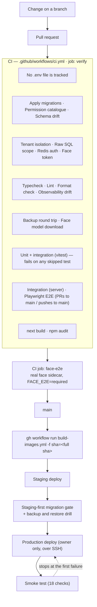

_Source: [`docs/architecture/15-ci-cd.mmd`](architecture/15-ci-cd.mmd)_

**Reading it.** The `verify` job in `.github/workflows/ci.yml` runs, in order:
a check that no `.env` file is tracked; migrations; the permission catalogue;
schema drift; tenant isolation; raw-SQL scope; demo credentials; seeded demo
data; typecheck; lint; format; observability drift; iOS package paths; Redis
auth; the face token gate; the face model download check; a backup round trip;
the test suite; the server-driven integration suite; Playwright E2E; `next build`;
and `npm audit`. **It fails on any skipped test.** A second job, `face-e2e`,
starts the real face sidecar, derives frames with `scripts/face-test-frames.mjs`
and runs `face-attendance.spec.ts` with `FACE_E2E=required` so it fails rather
than skips. Browser tests and `face-e2e` run only on PRs to `main` and pushes to
`main`. Other workflows: `build-images.yml`, `android-apk.yml`,
`ios-testflight.yml`.

### 6.5 Deployment and environments — _as the repository documents it_

Per `changes/PROJECT.md` §Releasing:

1. Merge to `main` and wait for its CI.
2. `gh workflow run build-images.yml -f sha=<full sha>`.
3. **The owner runs the release**: staging first, then the staging-first
   migration gate, a backup and restore drill, production, and the smoke test.
   It stops at the first failure.
4. Backups: RPO 24 hours. The preflight's `[backup-status]` lines in the release
   log are the production evidence — the nightly timer, its last run, the daily
   cadence over seven days, the newest off-site copy.

Environments: local Compose (`infra/docker-compose.yml`), staging
(`docker-compose.staging.yml`, `staging-gate.yml`, `Caddyfile.staging`),
production (`docker-compose.prod.yml`, `Caddyfile`), plus `azure`, `small-host`,
`pgbouncer` and `intranet` variants. `infra/systemd` and `provision-host.sh`
cover host set-up. **None of this was observed running from this session.**

### 6.6 Monitoring and incident handling

- `GET /api/health` — database and Redis, each with a 2-second ceiling, reported
  `up`/`down`; the body is `ok` or `degraded`. `GET /api/health/live` is the bare
  liveness probe.
- `GET /api/metrics` — Prometheus text. It **collects at scrape time** rather
  than being pushed to: queue depths, table sizes, connection counts, pending
  account deletions, secret ages and retention windows, with a collection
  timeout so a slow database degrades the scrape instead of hanging it.
- `infra/prometheus-alerts.yml` + Alertmanager; Grafana over Prometheus.
- CI has an **observability drift** gate that reads the `JOBS` table, which is
  why that table must stay a literal.
- Logs: `pino`, with `x-request-id` on every response — the id a user is shown in
  an error message is the id in the log line.
- Incident handling is documented in `docs/` rather than automated:
  `BACKUP-RECOVERY.md`, `OPERATIONAL-READINESS.md`,
  `PRODUCTION-RELEASE-PROCEDURE.md`, `OBSERVABILITY.md`, `OPS-DISK-RETENTION.md`.

### 6.7 Verified here versus recommended

**Verified from this commit:** the CI gate list, the job and schedule tables, the
queue list, the route/page/model counts, the compose service lists, the health
and metrics endpoints, the tenancy chain, the workflows in §4.

**Not verified and deliberately not claimed:** that production runs the commit
the docs name; that backups are running; that alerts reach anyone; that the AI,
telephony, calendar or portal integrations work against a real vendor.

**Recommended, not current (my assessment, not the repository's):**

1. Make the undeployed-commit gap visible automatically — the repository's own
   `PROJECT.md` records that its "production runs X" line was wrong for three
   weeks and a hotfix was cut from a stale commit on the strength of it. A CI
   step comparing `BUILD_COMMIT` from the last release log against `main` would
   turn a prose discipline into a check.
2. Decide the connection-pool question (`max` on `PrismaPg`) rather than leaving
   10 per process by default.
3. Set the retention windows on staging and production; the feature exists and is
   inert.
4. Resolve the mobile `server.url` architecture question before any further store
   submission (§2.5, §7).

---

## 7. Risks and gaps

Ranked by what would hurt most, each labelled with how it was established.

| #   | Risk or gap                                                                                                                                                                                                                                                                                                                                                                                                                                                                                            | Evidence                                                                                        | Status                                                                                                                                                                                                                                    |
| --- | ------------------------------------------------------------------------------------------------------------------------------------------------------------------------------------------------------------------------------------------------------------------------------------------------------------------------------------------------------------------------------------------------------------------------------------------------------------------------------------------------------ | ----------------------------------------------------------------------------------------------- | ----------------------------------------------------------------------------------------------------------------------------------------------------------------------------------------------------------------------------------------- |
| 1   | **ONE AI (the in-app assistant) was refused on every question.** A tool that takes no arguments (`getMyDay`) was declared to Google as `{type:'object',properties:{}}`, which Google rejects — and Google validates the whole request, so one bad declaration failed all sixteen tools for every question on every `google` credential.                                                                                                                                                                | `changes/2026-11-05-assistant-empty-tool-parameters.md`; fix in `src/lib/ai/provider.ts`        | **Fixed in code, unverified against the vendor.** The entry itself says so: this environment has no provider credential and no egress to the vendor, so the rejection is reproduced against Google's documented rule, not against Google. |
| 2   | **A green "Test connection" card did not mean the assistant worked.** The test called `GET /v1beta/models?key=…`, which sends no tools.                                                                                                                                                                                                                                                                                                                                                                | `src/lib/integrations/verify.ts`; `changes/2026-11-05-gemini-connection-proves-tool-calling.md` | Fixed: the connection check now sends the real tool declarations and reports "the key works, but … refused the assistant's tool declarations" separately.                                                                                 |
| 3   | **Google answers an invalid API key with 400 as well**, so an HTTP status alone cannot distinguish a malformed payload from a bad key.                                                                                                                                                                                                                                                                                                                                                                 | same entries                                                                                    | Mitigated in the product's wording; for a given failure only the logged response body under its error reference decides.                                                                                                                  |
| 4   | **Mobile: the shipping architecture is contradicted inside the repository.** `capacitor.config.js` says `server.url` is a development proof of concept that must not be submitted to a store; `docs/CURRENT_STATUS.md` records an iOS 1.2.0 submission awaiting review.                                                                                                                                                                                                                                | both files                                                                                      | **Unresolved — flagged, not decided here.**                                                                                                                                                                                               |
| 5   | **Read-only CRM monitoring cannot be granted to anyone.** Built (v1.4.0); the grant needs `openCoverage` to take a `kind`, and that edit needs the owner's permission.                                                                                                                                                                                                                                                                                                                                 | `changes/PROJECT.md`                                                                            | Blocked by a decision, not by code.                                                                                                                                                                                                       |
| 6   | **Leads have no retention window**, and the three windows that exist are empty by default (keep everything).                                                                                                                                                                                                                                                                                                                                                                                           | `changes/PROJECT.md`; `collectRetentionWindows` in the metrics route                            | Deliberate, but a data-protection gap worth naming.                                                                                                                                                                                       |
| 7   | **Connection pool is 10 per process and the URL's `connection_limit` is ignored.** A page reading many independent lists can take half the pool; `tests/sales/lead-page-connections.spec.ts` exists to measure that.                                                                                                                                                                                                                                                                                   | `src/lib/db.ts`, `changes/PROJECT.md`                                                           | Open operations decision.                                                                                                                                                                                                                 |
| 8   | **Live call coaching is dormant without `LIVE_STREAM_WS_URL`,** and no port is opened. Easy to read a successful call pipeline as proof that coaching ran.                                                                                                                                                                                                                                                                                                                                             | `src/workers/index.ts`                                                                          | By design; stated here so nobody assumes otherwise.                                                                                                                                                                                       |
| 9   | **Fragile external dependencies by nature.** Exotel and Knowlarity cannot sign callbacks (URL secret only); the portals deliver only to approved partners; Google requires verification of the `calendar.events` scope before customers outside the owner's Workspace can connect; AI silently falls back to labelled **simulation** without a key.                                                                                                                                                    | `registry.ts`, `changes/PROJECT.md`, `src/lib/ai/simulated.ts`                                  | Known and documented.                                                                                                                                                                                                                     |
| 10  | **Documentation inconsistencies found during this inspection.** `changes/PROJECT.md` contains duplicated paragraphs and two contradictory "Attendance is not HR" bullets; its header was wrong about production for three weeks, by its own account. `docs/CURRENT_STATUS.md` is dated 30 Oct and already behind the 5 Nov AI work. The root `README.md` still describes the old "Master SaaS" layout. `docs/product/DECISIONS-REQUIRED.md` holds 17 unanswered questions and was last touched 12 Sep. | read in this commit                                                                             | Open; `CURRENT_STATUS.md` lists the first as a tidy-up.                                                                                                                                                                                   |
| 11  | **Documents whose claims could not be checked from here.** `docs/qa/END-TO-END-ACCEPTANCE.md`, `docs/ACCEPTANCE-REPORT.md` and the requirement counts in `CURRENT_STATUS.md` (288 of 298 complete) describe test runs and production states this session did not observe.                                                                                                                                                                                                                              | —                                                                                               | **Unverified. Not restated as fact anywhere above.**                                                                                                                                                                                      |
| 12  | **Ten open items need the owner, not code** — push keys (FCM/APNs), a device pass on a real Android and iPhone, a Twilio account and one real call round trip, the self-serve sign-up setting, and the standalone app's store build.                                                                                                                                                                                                                                                                   | `docs/CURRENT_STATUS.md`, `changes/PROJECT.md`                                                  | Blocked on credentials and devices.                                                                                                                                                                                                       |

### Things this document could not verify at all

- Anything about the running production system: image digests, applied migration
  count, uptime, backup freshness, alert delivery.
- Whether any external vendor integration succeeds end to end.
- Whether the test suites pass right now — they were not run as part of writing
  this document.

---

## 8. Glossary

| Term                            | What it means here                                                                                                                                                                                       |
| ------------------------------- | -------------------------------------------------------------------------------------------------------------------------------------------------------------------------------------------------------- |
| **Workspace / tenant**          | One customer company. `Tenant` in the schema, a slug in every URL. All data is tagged with its `tenantId`.                                                                                               |
| **Module / product**            | A sellable part of the platform: `SALES`, `HRMS`, `REAL_ESTATE`, `LEAD_EAGLE`. A workspace is _entitled_ to some of them.                                                                                |
| **Entitlement**                 | The check "does this workspace own this module?". Fails with a named refusal, never a silent redirect.                                                                                                   |
| **Permission**                  | A module-plus-action pair (`leads:EDIT`) held by a role. Roles are rows in the database, per workspace.                                                                                                  |
| **Scope**                       | How far a permission reaches: `OWN` (just me) < `TEAM` (my reporting line and teams) < `BRANCH` < `REGION` < `ORGANIZATION` (everyone).                                                                  |
| **Row-level security (RLS)**    | A PostgreSQL feature where the database itself filters rows by a session variable — here `app.tenant_id`. The second line of defence behind the application's own guard.                                 |
| **`withTx` / `withPlatformTx`** | The two ways to open a transaction: one tenant's, or the platform's cross-tenant one. Nothing else may read across tenants.                                                                              |
| **Soft delete**                 | A `deletedAt` timestamp instead of removing the row, so history and audit survive.                                                                                                                       |
| **`route()`**                   | The API kernel. Takes a spec (module, action, schemas, audit event) and returns a Next.js handler with authentication, validation, permissions, idempotency, auditing and error mapping already applied. |
| **Idempotency key**             | A client-supplied header that makes a repeated send _replay_ the first answer instead of doing the work twice. Essential for the offline outbox and for calls that log themselves.                       |
| **Outbox**                      | A change made with no connection, stored on the device and sent when the connection returns.                                                                                                             |
| **BullMQ queue**                | A named list of background jobs in Redis. 11 of them here.                                                                                                                                               |
| **Scheduler / sweep**           | A repeating job armed at worker start (e.g. every five minutes) that looks for work that has come due.                                                                                                   |
| **Claim-guarded**               | A sweep that takes each row with a conditional UPDATE, so two overlapping runs do the work once between them.                                                                                            |
| **SSE (server-sent events)**    | A one-way stream from server to browser. Used to show live call coaching.                                                                                                                                |
| **STT**                         | Speech to text.                                                                                                                                                                                          |
| **Lead**                        | A potential buyer or tenant. The central record of the product.                                                                                                                                          |
| **Follow-up**                   | The next planned contact with a lead, with a due date and a kind (call, meeting, site visit, other).                                                                                                     |
| **Stage**                       | Where a lead is in the pipeline. The stages are each workspace's own.                                                                                                                                    |
| **SLA escalation**              | Telling a manager, and possibly re-assigning, when a lead is not contacted within its stage's minutes.                                                                                                   |
| **Cold data**                   | Bought or imported numbers that are not leads yet (`DataRecord`). Work on them still counts towards targets.                                                                                             |
| **Allocation / distribution**   | Deciding which agent gets a new lead, by rule.                                                                                                                                                           |
| **Daily Activity**              | The board of what each seller was asked to do today and has done, all counted from the work itself.                                                                                                      |
| **ONE AI**                      | The in-app assistant: a question in, approved CRM tools run under the asker's own permissions, an answer grounded only in what those tools returned.                                                     |
| **Simulation mode**             | What AI features do with no provider key: real records, templated answers, clearly labelled.                                                                                                             |
| **Masked field**                | A phone number or email hidden from a role without `leads:VIEW_SENSITIVE_FIELDS`. `dialable()` refuses to build a link from one.                                                                         |
| **Workspace clock**             | The company's own timezone. "Today" and every formatted date use it, not the server's.                                                                                                                   |
| **Platform console**            | The owner's area: workspaces, plans, subscriptions, AI budgets, monitoring grants.                                                                                                                       |
| **Trakheesi / ORN / WPS**       | UAE regulatory identifiers: a Dubai listing permit, a brokerage registration number, and the Wage Protection System for payroll.                                                                         |

---

## 9. Where to look next in the repository

| Question                                                        | File                                                                                               |
| --------------------------------------------------------------- | -------------------------------------------------------------------------------------------------- |
| The living project state and every rule a change must not break | `changes/PROJECT.md`                                                                               |
| What changed, newest first                                      | `changes/README.md`                                                                                |
| Where the project stands, and the owner's open items            | `docs/CURRENT_STATUS.md`, `docs/PROJECT_HANDOVER.md`                                               |
| The reading order and hard rules for an AI session              | `docs/AI_INSTRUCTIONS.md`                                                                          |
| The API, machine-readable                                       | `GET /api/v1/openapi.json`, `apps/web/public/openapi.json`                                         |
| Every queue and job                                             | `apps/web/src/lib/queue.ts`, `apps/web/src/workers/jobs.ts`, `apps/web/src/workers/maintenance.ts` |
| Every connectable vendor                                        | `apps/web/src/lib/integrations/registry.ts`                                                        |
| The tenancy guard                                               | `apps/web/src/lib/db.ts`                                                                           |
| The API kernel                                                  | `apps/web/src/lib/api/handler.ts`                                                                  |
| Permissions and scopes                                          | `apps/web/src/lib/security/rbac.ts`, `record-scope.ts`, `visibility.ts`                            |
| Known limitations, as the project records them                  | `docs/KNOWN-LIMITATIONS.md`                                                                        |
