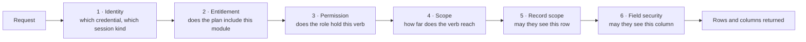
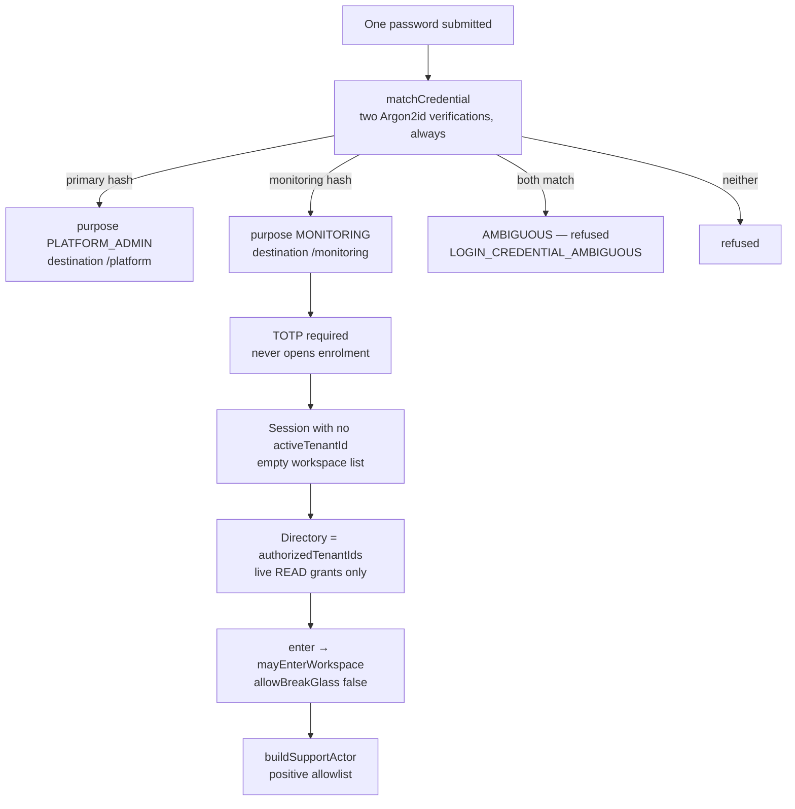

# Access control map

Who can see what, and where each decision is made. Paths relative to
`apps/web/`.

| | |
| --- | --- |
| Branch | `claude/ponytail-lite-0e416b` |
| Commit | `babbaa06db5620590e1308a6a1fa94054b304992` |
| Analysed | 12 Nov 2026 |

---

## The five axes

A request must satisfy all five. They are independent: holding a permission does
not imply entitlement, and entitlement does not imply reach.



| Axis | Enforced by | File |
| --- | --- | --- |
| Identity | `resolveCtx`, `resolveDeviceCtx`, `credentialRefusal` | `lib/auth/session.ts`, `lib/auth/credentials.ts` |
| Entitlement | `assertModuleEntitlement`, `route({ productModule })`, `resolveWorkspacePage` | `lib/security/entitlements.ts:64`, `lib/workspace-page.ts:91` |
| Permission | `assertPermission`, `can` | `lib/security/rbac.ts:147`, `:135` |
| Scope | `atLeast`, `visibilityWhere`, `resolveOwnerIds` | `lib/security/rbac.ts:140`, `lib/security/visibility.ts` |
| Record scope | `assertRecordInScope`, `assertLeadInScope` | `lib/security/record-scope.ts:209`, `:171` |
| Field security | `applyFieldSecurity`, `seesField`, `assertFilterableFields` | `lib/security/fieldSecurity.ts` |

---

## Platform roles versus workspace roles

These are two separate identity systems that meet at one table.

| | Platform | Workspace |
| --- | --- | --- |
| Who | The operator of the whole deployment and their support staff | A brokerage's own people |
| Stored on | `PlatformUser:1262` with `platformRole` | `Role:3220` rows + `MembershipRole:1587` |
| Roles | `OWNER`, support roles, `USER` | Created per workspace; a new workspace gets one, Company Admin, holding every permission |
| Where they act | `app/(platform)/platform`, `app/(monitoring)/monitoring` | `app/(workspace)/[workspaceSlug]` |
| Gate | `requirePlatformOwner` / `requirePlatformSupport` (`lib/auth/platform.ts:12`, `:50`) | `route({ module, action })` + `resolveWorkspacePage` |
| Fixed or editable | Fixed in code | Fully editable in the role editor |

A platform identity is **not** a workspace member. A monitoring session is
denied any membership actor outright (`lib/auth/session.ts:588-591`). To act
inside a workspace a platform person must *enter* it, which is audited and
re-checked on every subsequent request.

**Lead Eagle's starter roles.** A workspace with the Lead Eagle module gets five
editable starter roles at provisioning — Manager, Team Lead, Agent, Telecaller,
Viewer (`services/platform/provisioning.ts:135-171`). All but the Viewer may
send to their leads (`communications:CREATE`); the two that read numbers masked
(Telecaller, Viewer) have no inbox.

---

## Multi-role behaviour

A person can hold several roles in one workspace, and can be a member of several
workspaces.

- **Several roles in one workspace.** Roles are joined through
  `MembershipRole:1587` with effective dates, so an assignment can start and end.
  The effective permission set is the **union** of the roles in force, and scope
  resolves to the **highest** scope granted for each verb — `scopeFor` returns
  the strongest, and `atLeast(ctx, module, action, scope)` compares against the
  ranked ladder (`lib/security/rbac.ts:29`, `:140`).
- **Several workspaces.** One `PlatformUser` can own memberships in many
  tenants. The session carries `activeTenantId`; the server lands an account
  with two workspaces on the oldest. A workspace whose only usable product is
  Lead Eagle opens on its Lead Eagle dashboard
  (`workspaceLanding`, `lib/security/entitlements.ts`).
- **Role authority is bounded by your own.** Nobody can bind a person to a role
  they could not administer themselves — `assertMayAdministerRole`
  (`lib/security/rbac.ts:160`), applied in `services/identity/invitations.ts:78`
  and on every role change. `createStaffAccount` carries the same rank guard
  (`services/identity/accounts.ts:819`).

---

## Scopes

Five ranks, strictly ordered:

```
OWN  <  TEAM  <  BRANCH  <  REGION  <  ORGANIZATION
```

Checked with `atLeast(ctx, module, action, scope)`. Turned into a query by
`visibilityWhere`, which resolves the caller's owner ids via `resolveOwnerIds`
(`lib/security/visibility.ts`) — **never the whole workspace**, in a list and by
id alike.

| Scope | Means | Resolution |
| --- | --- | --- |
| `OWN` | Records you own | `ctx.actor.id`, plus `secondaryOwnerId` for leads |
| `TEAM` | Your reporting line below you, and your teams' members | `User.managerId` descended **every level** (`managedUserIds`), plus `UserTeam` |
| `BRANCH` | Everyone in your branch | `User.branchId` → `Branch:1065` |
| `REGION` | Everyone in your region | Branch → region |
| `ORGANIZATION` | The whole workspace | `{}` |

**A trap worth knowing: HR's TEAM is not the CRM's TEAM.** The lead side
descends the whole management tree. HR's `reportingLine`
(`services/hr/leave.ts:90-97`) is **self plus direct reports only, one level**,
matched on `EmployeeProfile.managerMembershipId`. So a second-line manager sees
their own reports' attendance but not their reports' reports'. This is
deliberate in the comments, but it means "the manager's whole line" is the wrong
description for HR.

**Attendance has its own audience function.** `attendanceScope`
(`services/hr/attendance.ts:63-67`) returns exactly three things: `{}` for an
ORGANIZATION `employee:VIEW` or `attendance:APPROVE` holder, the `reportingLine`
for a TEAM-and-above attendance approver, otherwise the caller's own id — or
`''` when they have no employee profile. Attendance-permissioned *reports*
specifically delegate to it (`services/hr/reports.ts:126-130`), so an attendance
report reaches the reporting line and not a manager's whole sales tree.

---

## Record scope: a 404, never a 403

A row loaded by id and found out of reach answers **404**, exactly as a missing
id does (`lib/security/record-scope.ts:209-224`). That is deliberate: a 403
would confirm the row exists and let an id be enumerated.

- `assertLeadInScope` (`:171`) loads by tenant + id, 404s if absent, then checks
  scope; a 404 is retried against `secondaryOwnerId` so a lead's second owner
  reaches it as its owner does.
- Read paths express the same rule as a `where`: `GET /api/v1/leads/{id}` does a
  `findFirst` with `leadScope` merged in and throws `NotFound` on null.
- `assertAssignableUser` / `assignableUserWhere` bound **who may be named as a
  new owner** — an active member inside the caller's ASSIGN scope, 404
  otherwise. Applied wherever work changes hands.

**Verified:** every dynamic API route either calls an `assert*InScope` member or
is a workspace-wide configuration object gated by its module permission. The
scan was extended to dynamic `page.tsx` files and found nothing new.

---

## Field security

A separate axis: *which columns*, not which rows.

- A lead's phone numbers and email are masked for a role without
  `leads:VIEW_SENSITIVE_FIELDS` (`LEAD_SENSITIVE_FIELDS`,
  `services/leads/createLead.ts:31`).
- Every egress path serialises through `applyFieldSecurity`, `asLeadPhone` or
  `maskCallNumbers`; `tel:` and `wa.me` links are built with `dialable()`, which
  refuses a mask.
- `assertFilterableFields` exists because filtering or sorting on a hidden field
  would let a caller recover the value by binary search
  (`lib/security/fieldSecurity.ts:94-96`). Applied in
  `app/api/v1/{leads,contacts,accounts}/route.ts`.
- Lead masking is sound on every traced path: grid, list API, CSV/XLSX export,
  timeline, merge screen, mobile, call follow-up email, and search (exact-match
  only for a masked role).

**Three gaps, all in [`FINDINGS.md`](FINDINGS.md):** contact/account/opportunity
`VIEW_SENSITIVE_FIELDS` is a grantable permission that masks nothing (no
sensitive-field map exists and nothing writes a `FieldPermission` row); the
shared CSV export route applies no field-security pass; and the assistant's
`searchContacts` offers a phone **suffix** filter with no `assertFilterableFields`
and returns the number raw. Those three must be fixed together — fixing the
first alone converts a dormant gap into a working oracle.

---

## Subscription and module enforcement

A plan enables modules; modules gate screens and routes. Three enforcement
points:

| Point | How | File |
| --- | --- | --- |
| Page | `resolveWorkspacePage(slug, { module, permission })` | `lib/workspace-page.ts:91` |
| API route | `route({ productModule })` | `lib/api/handler.ts` |
| Layout | `workspaceOwns` renders `NotInPlan` | `app/(workspace)/[workspaceSlug]/layout.tsx:27` |

Shared screens assert a **set**: `LEAD_MODULES` (Sales, Real Estate, Lead Eagle)
for lead work, `SALES_OR_REALTY` for money and marketing, `PRODUCT_MODULE_KEYS`
for any module.

**Two subtleties that matter.**

1. **Next still renders the page beneath `NotInPlan`**, so a layout gate is not
   enough — *every* page in a module folder asserts its own module. Enforced by
   `tests/permission/page-access.spec.ts`.
2. **A module the plan lacks shows `NotInPlan`, never a silent redirect.**
   `NotInPlan` sends the viewer to the same screen under a product the plan does
   have (`sameScreenElsewhere`), else names every product that carries it. The
   API's refusal names every module of the set.

**Usable states** are TRIAL, ACTIVE and GRACE (`lib/security/entitlements.ts`).
A plan change deletes entitlements outside the new plan
(`app/api/v1/platform/subscriptions/[subscriptionId]/route.ts:67-88`); an
unrelated workspace save leaves a paying customer's modules alone, asserted by
`tests/platform/workspace-edit-entitlements.spec.ts:62`.

**No billing provider is wired.** Plans and subscriptions are internal rows.

---

## Monitoring: the read-only support path

A second, separate access mode for the operator's support staff. This is the
most tightly constrained path in the product.



**How the two passwords are told apart.** Nothing the client sends names a mode.
`matchCredential` verifies the submitted password against both `passwordHash` and
`monitoringPasswordHash` — exactly two Argon2id verifications every time, an
empty slot against a dummy digest — so neither timing nor result reveals which
slot matched (`lib/auth/credentials.ts:38-62`). Both matching is AMBIGUOUS and
fails closed. A monitoring password is refused on a non-staff identity and
refused entirely unless a factor is already enrolled.

**What read-only actually means.** `buildSupportActor`
(`lib/auth/support-actor.ts:114`) requires
`!monitoringOnly && platformRole === 'OWNER' && activeGrant(...)` for
`fullControl` — so a monitoring session is **never** elevated, even by a live
WRITE grant the same identity holds. Without `fullControl` only `VIEW` and
`VIEW_REPORTS` rows load, then narrowed by a **positive allowlist**: modules
`leads, calls, activities, tasks, visits, tickets` and action `VIEW` only. So no
`VIEW_SENSITIVE_FIELDS`, no payroll, no reports — and a module added next
quarter is not granted by default.

**Re-checked, not just gated at the door.** `supportSessionActor`
(`lib/auth/session.ts:655-673`) calls `mayEnterWorkspace` again on every request,
so a revoked grant bites immediately. `credentialRefusal`
(`lib/auth/credentials.ts:87-117`) revokes on a purpose mismatch, a revoked
monitoring credential, a changed credential, or a legacy session with no purpose.

**Enumeration-safe.** The enter route answers 404 rather than 403 for a
workspace you hold no grant on, so it cannot be used to enumerate customers.

**Three limitations, confirmed:**

1. **CRM monitoring is built but ungrantable.** `openCoverage` takes no `kind`
   parameter and writes none (`lib/auth/platform-access.ts:343-384`), so every
   coverage row falls to the schema default `OPERATIONAL`. `activeCrmMonitoring`
   can therefore never return a row in production, and the directory's standing-
   entitlement branch is dead code until that edit is made. `changes/PROJECT.md:462`
   says exactly this, and it is correct.
2. **There is no operator UI for monitoring grants.** The only references to
   `monitoring/grants` in `src` are that route file's own error strings; the
   callers are tests. READ grants and coverage are API-only, while
   `changes/PROJECT.md:42` lists "monitoring grants" among the console's screens.
3. **A grant-holder can enter a SUSPENDED or ARCHIVED workspace.** The enter
   route's `where` is `{ id, deletedAt: null }` — `status` is only in the
   `select` — and `mayEnterWorkspace` checks nothing but
   `activeGrant('READ')`, break-glass `WRITE` and `activeCoverage`. No
   tenant-status check exists in that path, though the directory will not list
   such a workspace. A code comment at `app/(monitoring)/monitoring/page.tsx:74-78`
   claims the opposite.

**Break-glass** is the owner's separate WRITE path: owner-only, reason-bound,
time-boxed, and every read under it is labelled `mode=break-glass` in the
customer's own audit trail.

---

## Tenant isolation

Four layers, detailed in [`SYSTEM-MAP.md`](SYSTEM-MAP.md) §3: the client guard in
`lib/db.ts` (fan-in 736) refuses a query naming no tenant; `withTx` sets the
tenant on one pooled connection; Postgres row-level security is FORCED on every
`tenantId` table; and record scope checks each by-id load. The process refuses
to boot if the runtime role is a superuser, holds `BYPASSRLS`, shares the
migration connection string, or owns an unforced RLS table
(`lib/startup-check.ts:158-206`). CI re-checks the live catalog
(`.github/workflows/ci.yml:225`).

Cross-tenant reads go through `withPlatformTx` and nothing else.

---

## Audit

The rule for new code: every write leaves an `AuditLog` row, through the route's
`auditEvent` or `audit(ctx, …)`. A write no person makes calls
`audit({ tenantId, source }, …)` and shows as System.
`tests/unit/mutation-audit.spec.ts` gates it — every POST, PATCH, PUT and DELETE
handler must declare `auditEvent`, audit in its handler, or be listed there with
the file that audits it or why nothing is recorded.

A file leaving the building needs EXPORT, not VIEW, and writes
`EXPORT_REQUESTED`; a scheduled report email is one too, re-checked at every
send.

**One gap:** an idempotent replay skips the audit row, so a committed write can
exist with no `AuditLog` entry (`lib/api/handler.ts:279` vs `:283`). See
[`FINDINGS.md`](FINDINGS.md).
