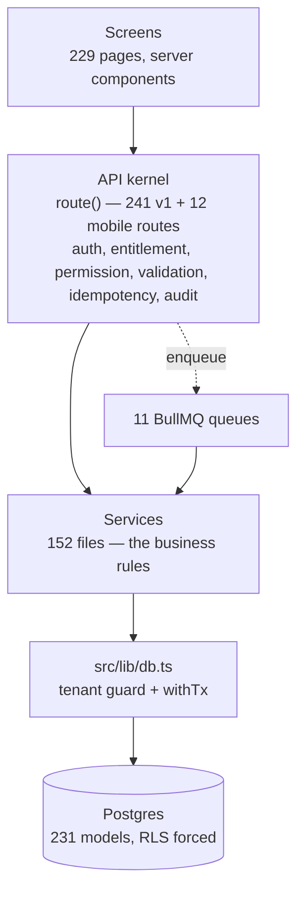

# Product overview

What YOUHAN ONE is, in plain English, and how its parts fit together.

| | |
| --- | --- |
| Branch | `claude/ponytail-lite-0e416b` |
| Commit | `babbaa06db5620590e1308a6a1fa94054b304992` |
| Analysed | 12 Nov 2026 |

Written from source at that commit. Nothing here is evidence that a feature is
deployed or configured in production — see
[`MODULE-INVENTORY.md`](MODULE-INVENTORY.md) for what is live versus waiting on
credentials.

---

## The product in one paragraph

YOUHAN ONE is a multi-tenant SaaS platform for UAE real-estate brokerages and
sales teams. One deployment serves many brokerages ("workspaces"), each isolated
at the database level. A workspace buys a plan, the plan enables product
modules, and the modules decide which screens its people can open. The work
itself is lead management: an enquiry arrives from a property portal, gets
allocated to an agent, is called and followed up, becomes a booking on a
property unit, and produces a commission that is collected and paid out.
Alongside that sits a full HR system — attendance by face recognition, leave,
payroll — because a brokerage's agents are also its employees.

## The four products

A workspace is entitled to some combination of four modules
(`apps/web/src/lib/modules/catalogue.ts`). They are **not** four codebases:
they are four doors onto mostly the same records.

| Module | Folder | Pages | What it is for |
| --- | --- | --- | --- |
| **Sales** | `sales/` | 76 | The full CRM: leads, contacts, accounts, opportunities, calls, campaigns, bookings, collections, commissions, proposals, reports |
| **Real Estate** | `realty/` | 43 | The same screens as a brokerage works them, plus Properties, the data pool, events with QR passes, lead recycling |
| **Lead Eagle** | `lead-eagle/` | 33 | Lead management on its own — the lead screens without the money and marketing ones. Has its own sign-in door |
| **HRMS** | `people/` | 32 | Employees, attendance, shifts, roster, leave, overtime, payroll, payslips, WPS, recruitment, performance |

**The rule that makes this work:** one record, several screens. Real Estate and
Lead Eagle reuse Sales' own rows — `Lead`, `Call`, `SiteVisit`, `Booking`,
`Project`, `Listing`, `UnitInventory` — and their pages are literally one-line
re-exports of the Sales pages. 41 of 43 `realty/` pages and 33 of 33
`lead-eagle/` pages contain an `export … from`, guarded by
`tests/unit/realty-routes.spec.ts` and `lead-eagle-routes.spec.ts`. There is no
parallel data model per product, and adding one is explicitly forbidden.

Outside the four modules, every workspace gets check-in and attendance,
`admin/` (users, roles, work locations, settings, retention, audit) and
`profile/`. Above them all sits a platform console
(`apps/web/src/app/(platform)/platform`, 16 pages) where the operator
provisions workspaces, edits plans and subscriptions, and runs the AI Control
Center.

## How a brokerage's day flows through the system

1. **An enquiry arrives.** A portal (Property Finder, Bayut, dubizzle), a Google
   Ads lead form, a signed custom webhook, a forwarded portal email, a WhatsApp
   message from an unknown number, or a call from an unknown number. Each
   delivery is stored verbatim as a `WebhookEvent` *before* anything interprets
   it, then interpreted on a queue — so a parsing change can be replayed against
   the original.
2. **It becomes a lead and is allocated.** `takeEnquiry` de-duplicates on a
   phone number or an email, never on a name alone, and creates the `Lead`.
   A `distribution` job then runs a weighted round robin over the first matching
   rule's pool, asks one shared eligibility gate (is this person active, on
   shift, under quota, not on leave, available?), and re-verifies the winner
   under a row lock. A lead nobody can take becomes a recorded triage entry
   rather than a silent null owner.
3. **An agent works it.** Call it, log the call in one step (which also books
   the next follow-up), move it through the workspace's own pipeline stages,
   record a requirement and link properties of interest. Overdue and due
   follow-ups are counted on the workspace's clock. If nobody makes first
   contact within the stage's minutes, the manager is told and the lead can be
   taken back once.
4. **It becomes a booking.** A booking names a buyer (lead, contact or account)
   and something sold (project, listing or unit). Confirming it takes the unit's
   row lock and moves the unit to BOOKED, which is what stops two agents selling
   the same apartment.
5. **Money.** A commission is accrued against the confirmed booking from a
   signed slab, and the rule that produced it is frozen onto the row — the
   ledger is never edited backwards, a cancellation writes a negative reversal.
   Receipts are recorded and then verified by a different person. A payout run
   is built by one person and approved by another, and only a payout marks a
   commission PAID.
6. **Meanwhile, HR.** The same people check in by face at a work location,
   request leave, accrue overtime from their punches, and are paid by a payroll
   run that one person prepares and another approves.

**An important gap in that chain:** step 4 does not require step 3's
opportunity, and step 5 does not follow automatically from step 4. See below.

## How the layers fit

Four things are worth knowing about this shape:

- **`src/lib/db.ts` is the single chokepoint.** It has a fan-in of **736** —
  three quarters of the codebase routes its reads through it. Every query must
  name its tenant or be refused, and Postgres row-level security backs that up.
  A defect there is product-wide, which is why it is the most carefully guarded
  file in the repository.
- **`src/lib/api/handler.ts` is the single prologue.** One function applies
  authentication, rate limiting, entitlement, permission, body caps, validation,
  idempotency and audit, in that order, for every API route. Routes are thin.
- **The business rules live in services, not routes.** Separation of duties on
  payouts and receipts, maker-checker on payroll, the commission status machine
  — all of it sits in `src/services/**` so no route can skip it.
- **There is no layering between `lib` and `services`.** The dependency graph
  shows one 27-module strongly-connected component spanning every `lib/*` and
  `services/*` area. It works, but nothing stops it growing. See
  [`FINDINGS.md`](FINDINGS.md).

## What governs who sees what

Three independent axes, all enforced server-side. [`ACCESS-CONTROL-MAP.md`](ACCESS-CONTROL-MAP.md)
has the detail.

- **Entitlement** — does the workspace's plan include this module? A page
  asserts it with `resolveWorkspacePage`, an API route with
  `route({ productModule })`.
- **Permission and scope** — does this role hold this verb, and how far does it
  reach? Roles are database rows. Scopes run OWN < TEAM < BRANCH < REGION <
  ORGANIZATION.
- **Record scope** — may this person see *this row*? Checked on every by-id
  load, and a row out of scope answers 404, not 403, so an id cannot be
  enumerated.

Sensitive fields are a fourth concern: a lead's phone numbers and email are
masked for a role without `leads:VIEW_SENSITIVE_FIELDS`, on every egress path
including exports and the AI assistant.

## The AI layer

**ONE AI** is a tool-calling assistant mounted workspace-wide as a widget, not a
page. It declares 16 CRM tools; each tool carries its own required permissions
as data, and one function enforces them before any tool runs. Inside each tool,
rows are scoped with the same helpers the list pages use. Write-style tools
never write — they return a proposed action the user must confirm through the
normal REST endpoints.

Separately, calls are transcribed, analysed, audited and coached by the same
provider layer, on a queue with per-tenant fairness so one busy brokerage cannot
starve another.

A workspace connects its own Gemini or OpenRouter key. If its connection is
broken, it does **not** silently fall back to the deployment's key — it drops to
a labelled simulation and says why. With no key at all, a keyword template
router answers from the same real CRM data, clearly labelled.

## Where the product is incomplete

These are architectural facts, not opinions, and each is evidenced in
[`FINDINGS.md`](FINDINGS.md).

- **Opportunities are not in the path.** Nothing converts a lead into an
  opportunity, and `Booking` has no `opportunityId` column. A lead can reach a
  confirmed booking and a paid commission with no `Opportunity` row ever
  existing. Opportunities are an optional parallel record, not a pipeline stage.
- **Commission is never automatic.** Confirming a booking enqueues nothing;
  somebody must call the accrual endpoint by hand.
- **Manual lead creation never reaches automatic assignment.** Round-robin
  distribution runs only for intake leads with no owner, for triage and SLA
  re-assignment, and for leads routed back to a team pool.
- **A Lead-Eagle-only workspace has no route from a lead to a booking**, because
  bookings and opportunities are Sales-module objects while leads are available
  to all three lead products.
- **Most external integrations are code-complete but unconfigured.** Telephony,
  WhatsApp, both calendars, the portals and AI all ship working implementations
  and no credentials. Object storage, SMTP, ClamAV and the face service are the
  ones actually configured in this repository.

## Where to read next

| Question | Document |
| --- | --- |
| How is it put together? | [`SYSTEM-MAP.md`](SYSTEM-MAP.md) |
| What exists, and is it finished? | [`MODULE-INVENTORY.md`](MODULE-INVENTORY.md) |
| Who can see and do what? | [`ACCESS-CONTROL-MAP.md`](ACCESS-CONTROL-MAP.md) |
| I need to change X — what breaks? | [`CHANGE-IMPACT-GUIDE.md`](CHANGE-IMPACT-GUIDE.md) |
| What is wrong with it? | [`FINDINGS.md`](FINDINGS.md) |
| What are the project's own rules? | `changes/PROJECT.md` |
| What changed recently and why? | `changes/README.md` |
