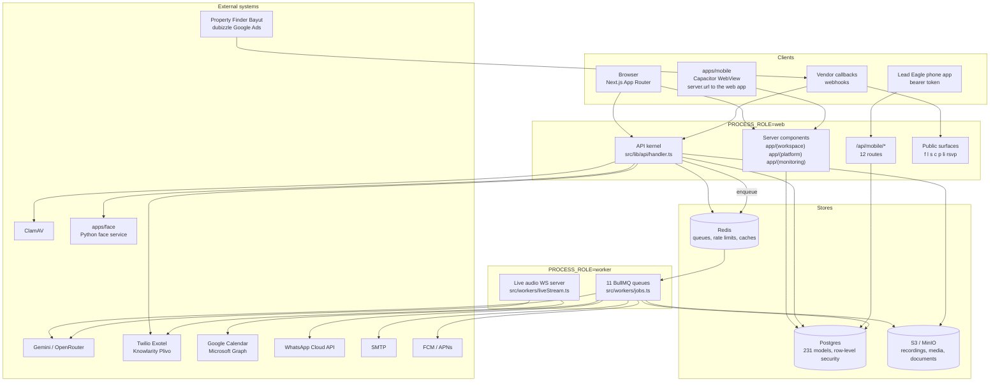
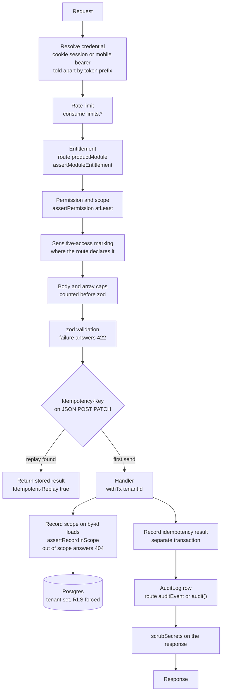
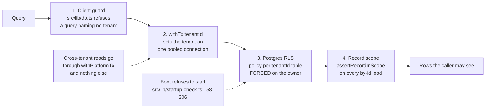
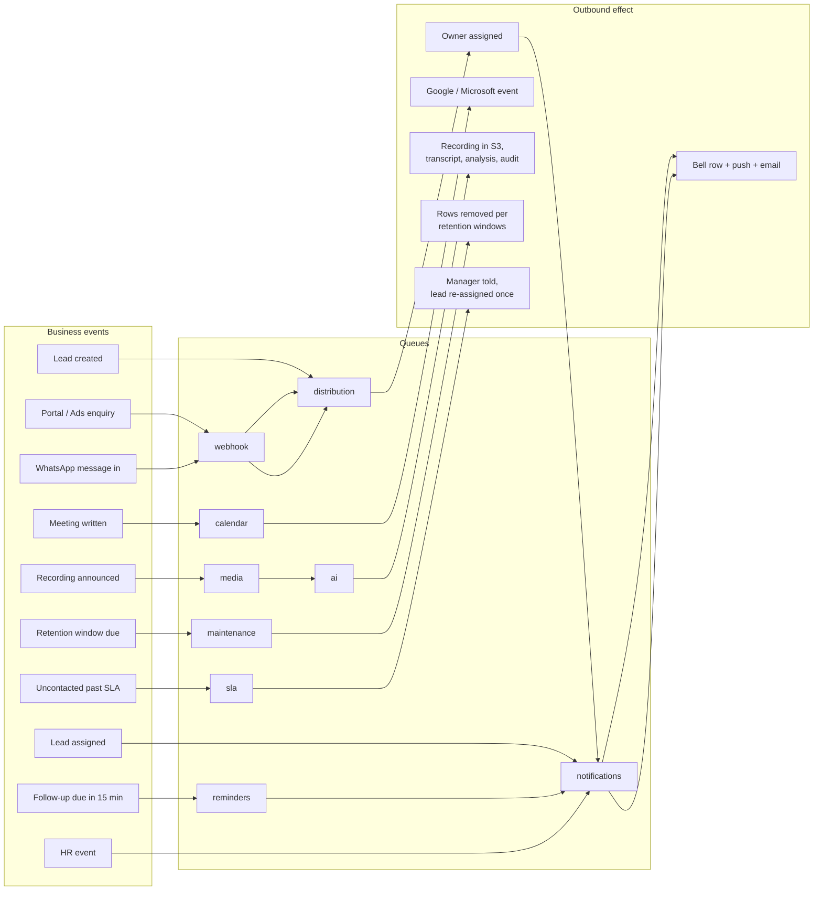
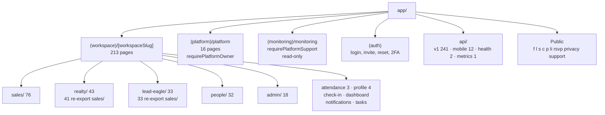
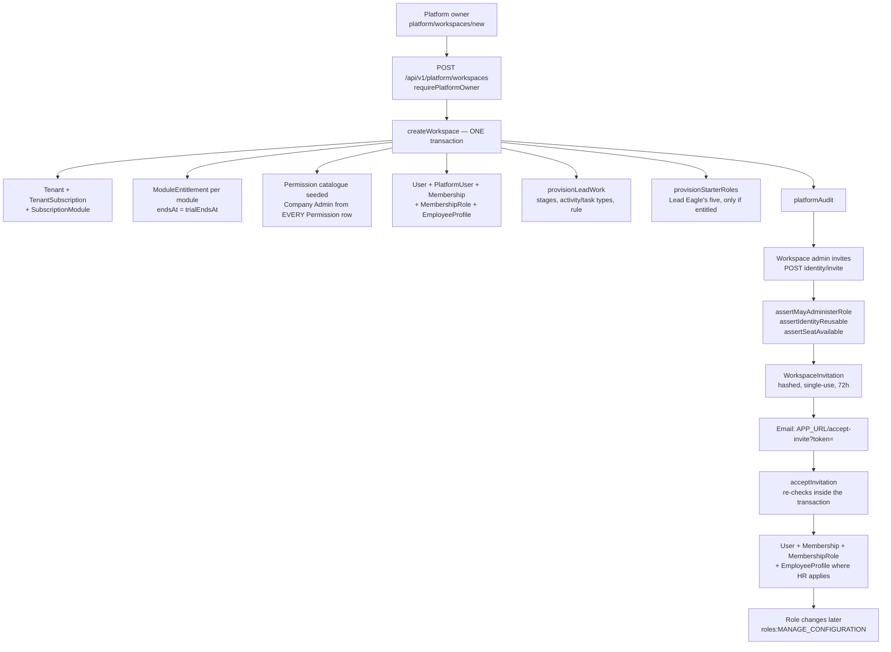
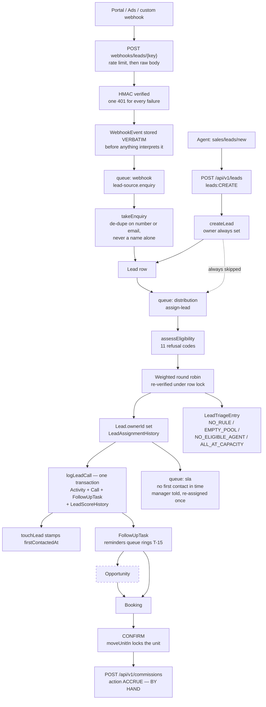
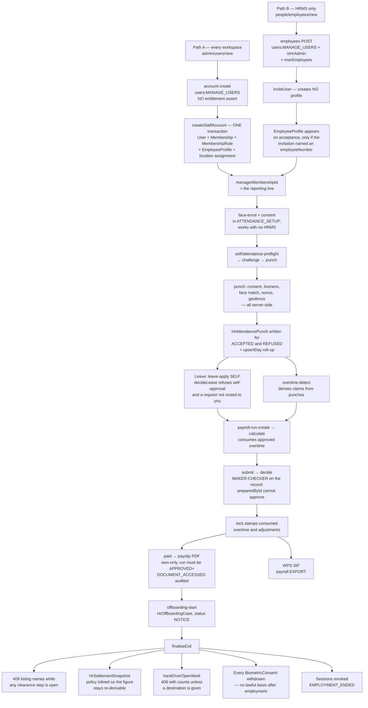
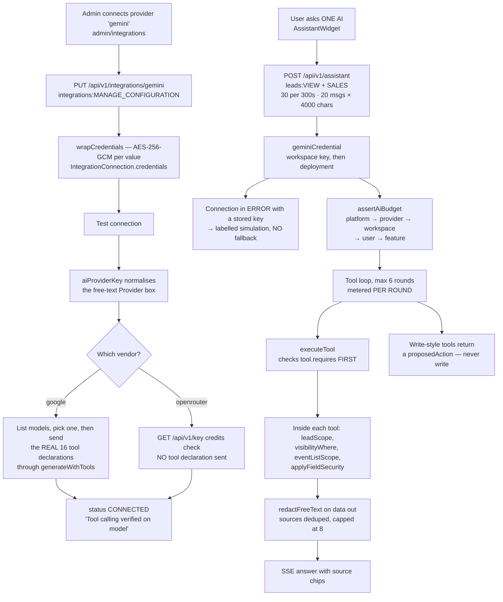
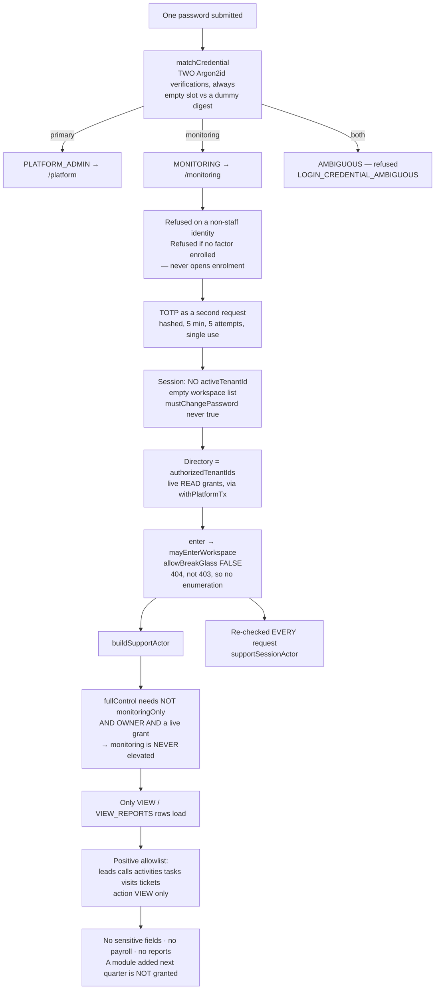

# System map

Diagrams of how YOUHAN ONE is put together, drawn from source at one commit.

| | |
| --- | --- |
| Branch | `claude/ponytail-lite-0e416b` |
| Commit | `babbaa06db5620590e1308a6a1fa94054b304992` |
| Analysed | 12 Nov 2026 |
| Method | Graphify AST extraction (10,206 nodes, 36,388 edges, 311 communities, 99% `EXTRACTED`) plus targeted source reading |

Every box and arrow below is traceable to a file. Where a relationship is
reasoned rather than read, the text says **inferred**. Static analysis does not
prove runtime behaviour: nothing here is evidence that a feature is deployed,
configured or working in production.

Companion documents: [`PRODUCT-OVERVIEW.md`](PRODUCT-OVERVIEW.md),
[`MODULE-INVENTORY.md`](MODULE-INVENTORY.md),
[`ACCESS-CONTROL-MAP.md`](ACCESS-CONTROL-MAP.md),
[`CHANGE-IMPACT-GUIDE.md`](CHANGE-IMPACT-GUIDE.md),
[`FINDINGS.md`](FINDINGS.md).

---

## 1. Processes and stores

Two process roles run from one codebase, chosen by `PROCESS_ROLE`
(`apps/web/src/lib/env.ts:92`). The worker process refuses to stay up unless
every queue's worker actually attached (`apps/web/src/workers/index.ts:17-44`).



**Confirmed:** process split (`env.ts:92-94`); 11 queues as a value, not a type
(`src/lib/queue.ts:13`); `JOBS` typed `Record<QueueName, Jobs>` so an undrained
queue is a compile error (`src/workers/jobs.ts:31`); the mobile shell is a
WebView over the same server, so a web deploy updates the phones
(`apps/mobile/README.md:3`).

**Caveat:** every external system except object storage, SMTP, ClamAV and the
face service is **code-complete but unconfigured in this repo** — see
[`MODULE-INVENTORY.md`](MODULE-INVENTORY.md) and `changes/PROJECT.md:450-460`.

---

## 2. A request through the API kernel

`route()` and `bareRoute()` (`apps/web/src/lib/api/handler.ts`) are the single
prologue for 241 `v1` routes and 12 mobile routes. The order below is the
enforcement order, read from the handler.



**Confirmed:** P2002 answers 409, P2025 404, a zod failure 422
(`changes/PROJECT.md:228-231`); the array cap is counted before zod runs; out of
scope answers 404 rather than 403 so an id cannot be enumerated
(`apps/web/src/lib/security/record-scope.ts`).

**Two known defects in this path**, both in [`FINDINGS.md`](FINDINGS.md): the
idempotency record is written in a *second* transaction after the handler and
its failure is swallowed (`handler.ts:411-419`), and a replay skips the audit
row (`handler.ts:279` vs `:283`).

---

## 3. Tenant isolation

Four independent layers. A query that names no tenant is refused before it
reaches Postgres, and Postgres would return nothing anyway.



**Confirmed:** `src/lib/db.ts` has fan-in **736** — three quarters of the
codebase routes its reads through it, which is why a defect there is
product-wide. `startup-check.ts:158-206` refuses to boot if the runtime role is
a superuser, holds `BYPASSRLS`, shares the migration connection string, or owns
an RLS table that is not `FORCED`. CI re-checks the live catalog for a policy on
every `tenantId` table (`scripts/check-rls.mjs`, gated at
`.github/workflows/ci.yml:225`).

**The documented trap:** inside `withTx`, the *global* client runs on another
connection with no tenant set, where RLS returns nothing — so a permission or
field-rule read taken that way reads as "no rule". A full scan of every
transaction callback found **no live instance** of this.

---

## 4. Business event to outbound effect

Eleven queues. Concurrency is 1 everywhere except `ai`, which runs 6 with a
per-tenant fair share (`src/workers/ai.ts:23,38`). Job ids are a SHA-256 of
queue + name + payload, so a duplicate trigger converges on one side effect
(`src/lib/queue.ts:117`).



### Scheduled sweeps

All on the `maintenance` queue except reminders, which has its own so a long
maintenance job cannot delay it (`src/workers/maintenance.ts:192-201`).

| Cron | Job | Queue |
| --- | --- | --- |
| `*/5 * * * *` | `triage-sweep`, `first-contact`, `automation-time` | `maintenance` |
| `*/5 * * * *` | `sweep` (reminders, 15 min look-ahead) | `reminders` |
| `*/15 * * * *` | `account-deletions`, `report-schedules`, `calendar-sync-retry` | `maintenance` |
| `5 * * * *` | `digest` (sends from 08:00 on each workspace's clock) | `maintenance` |
| `0 3 * * *` | `retention` | `maintenance` |
| `20 3 * * *` | `follow-up-drift` | `maintenance` |
| `40 3 * * *` | `lead-score-decay` | `maintenance` |
| `10 4 * * *` | `lead-recycle` | `maintenance` |
| `every 60s` | `campaign-sweep` | `campaign` |

Schedules read from `src/workers/maintenance.ts:224-253` and
`src/workers/campaigns.ts:11`. The `maintenance` queue allows **1 attempt** —
the next sweep is the retry (`src/lib/queue.ts:41`).

**A known consequence**, in [`FINDINGS.md`](FINDINGS.md): because the maintenance
worker runs one job at a time, the quarter-hourly report-email batch can starve
the five-minutely SLA sweeps.

---

## 5. Route groups



**Confirmed counts** from the filesystem at this commit. The re-export rule —
`realty/` and `lead-eagle/` pages are one-line re-exports of `sales/` pages so
one record serves several screens — holds: 41 of 43 and 33 of 33 contain an
`export … from`. The two exceptions (`realty/dashboard`, `realty/properties`)
are legitimately Real-Estate-only screens. Guarded by
`tests/unit/realty-routes.spec.ts` and `lead-eagle-routes.spec.ts`.

---

## 6. Key journeys

Five journeys traced through source. Each step is **confirmed** (the code was
read) unless marked *inferred*.

### 6.1 Create workspace → configure modules → invite users → assign roles



| | |
| --- | --- |
| **Entry** | `app/(platform)/platform/workspaces/new/page.tsx` → `POST app/api/v1/platform/workspaces/route.ts:57` |
| **Key files** | `services/platform/createWorkspace.ts:42-310`, `provisioning.ts:52-290`, `services/identity/invitations.ts:74-344`, `roles.ts:312` |
| **Data written** | `Tenant`, `TenantSubscription`, `SubscriptionModule`, `ModuleEntitlement`, `Permission`, `Role`, `RolePermission`, `User`, `PlatformUser`, `WorkspaceMembership`, `MembershipRole`, `EmployeeProfile`, `Pipeline`, `PipelineStage`, `LeadStage`, `ActivityType`, `TaskType`, `DistributionRule`, `WorkspaceInvitation`, `PlatformAuditEvent`, `AuditLog` |
| **Permission checks** | `requirePlatformOwner` (create, edit); `route({ module: 'users' })` (invite); `assertMayAdministerRole`; `assertSeatAvailable`; `roles:MANAGE_CONFIGURATION` |
| **Jobs** | None on the provisioning transaction. *Inferred:* whether the invitation email queues or sends inline was not read |
| **Tests** | `tests/tenant/provision-lead-work.spec.ts:119,125,324`, `tests/platform/workspace-edit-entitlements.spec.ts:62,76`, `tests/security/platform-admin-crud.spec.ts`, `tests/platform/self-serve-signup.spec.ts` |

Company Admin is built from **every** `Permission` row rather than a
hand-maintained list — the comment at `createWorkspace.ts:155-169` records that
the old list had missed 36 of 61 modules.

### 6.2 Lead → allocate → contact → follow-up → opportunity → booking → commission



**The dashed box is the finding.** Nothing creates an `Opportunity` from a lead,
and `Booking` has no `opportunityId` column, so the opportunity is a parallel
optional record rather than a stage. And confirming a booking enqueues nothing —
the accrual is a manual call.

| | |
| --- | --- |
| **Entry A** | `app/api/v1/webhooks/leads/[key]/route.ts:25` |
| **Entry B** | `sales/leads/new/page.tsx:15` → `POST app/api/v1/leads/route.ts:170` |
| **Key files** | `services/leads/intake.ts:49,169`, `createLead.ts:147`, `services/distribution/assignLead.ts:223`, `eligibility.ts:200`, `services/leads/logCall.ts:44`, `nextFollowUp.ts:145`, `services/sla/checkLeadFirstContact.ts`, `app/api/v1/bookings/route.ts:85,203`, `services/money/commissions.ts:104` |
| **Data written** | `WebhookEvent`, `Lead`, `LeadPhone`, `LeadStageHistory`, `LeadAssignmentHistory`, `LeadCustomFieldValue`, `LeadTriageEntry`, `Activity`, `Call`, `FollowUpTask`, `LeadScoreHistory`, `TargetProgress`, `Notification`/`NotificationOutbox`, `Opportunity`, `Booking`, `UnitInventory`, `Commission`, `AuditLog` |
| **Permission checks** | Webhook: none — tenancy from the unguessable `webhookKey` plus signature. Manual: `leads:CREATE` + `LEAD_MODULES`; `assertAssignableUser`; `assertLeadInScope(… 'EDIT')` on every by-id write; `agencyfee:CREATE` separately on a booking's fee; `commissions:EDIT` to accrue |
| **Jobs** | `webhook/lead-source.enquiry` → `distribution/assign-lead`, `sla/lead-first-contact` (delayed), `automation/trigger`, `notifications/record-push`, `reminders/sweep`, `calendar/calendar-sync` |
| **Tests** | `tests/sales/lead-source-intake.spec.ts`, `custom-webhook.spec.ts`, `allocation.spec.ts`, `assignment-working-hours.spec.ts`, `lead-triage*.spec.ts`, `sla-escalation.spec.ts`, `next-follow-up.spec.ts`, `lead-call-log.spec.ts`, `bookings-route.spec.ts`, `commissions.spec.ts`, `tests/permission/lead-record-scope.spec.ts` |

### 6.3 Onboard employee → team/branch → attendance & leave → payroll → offboarding



| | |
| --- | --- |
| **Entry A** | `admin/users/new/page.tsx` → `POST .../identity/[action]` `account-create` → `services/identity/accounts.ts:812`. **No entitlement assert in that route file** |
| **Entry B** | `people/employees/new/page.tsx` → `POST .../hr/[resource]` `employees:168` → `inviteUser:215` |
| **Key files** | `services/identity/accounts.ts:812-928`, `services/identity/invitations.ts:284-320`, `services/hr/attendance.ts:63,317,665,790`, `face.ts:97`, `leave.ts:268,341`, `overtime.ts:173,429`, `payroll.ts:215,267,609,642,686,746`, `wps.ts:161`, `lifecycle.ts:362,499` |
| **Data written** | `User`, `WorkspaceMembership`, `MembershipRole`, `EmployeeProfile`, `HrEmployeeLocationAssignment`, `HrChecklistTask`, `BiometricConsent`, `HrFaceTemplate`, `HrAttendancePunch`, `HrAttendanceRecord`, `HrLeaveRequest`, `HrLeaveBalance`, `HrOvertimeRequest`, `HrPayrollRun`, `HrPayslip`, `HrPayslipLine`, `HrPayrollAdjustment`, `HrCompensation`, `HrOffboardingCase`, `HrSettlementSnapshot`, `AuditLog` |
| **Permission checks** | `users:MANAGE_USERS` + role-rank guard (A); `+ isHrAdmin` + `maxEmployees` (B); `employee:EDIT` for onboarding and enrolment; **nothing beyond self-service for a punch**; `leave:APPROVE` + not-self + routed-to-you; `overtime:APPROVE`; `payroll:{CREATE,EDIT,APPROVE,EXPORT}` with maker-checker on the record; `employee:EDIT` for offboarding |
| **Jobs** | `notifications/hr-event` + `record-push` for HR notices; no queue job on a punch |
| **Tests** | `tests/hr/employee-record-scope.spec.ts`, `attendance-manager.spec.ts:77,83,111`, `punch-validation.spec.ts`, `punch-rejections.spec.ts`, `self-service-route.spec.ts:174,202`, `roster.spec.ts`, `overtime.spec.ts`, `payroll.spec.ts:59-183`, `tests/security/hr-action-authority.spec.ts:116,128,132`, `tests/e2e/face-attendance.spec.ts` |

Historical records — punches, payslips, attendance days, closed leads — are
**kept** on exit. Only consent and access end.

### 6.4 Configure AI → validate → ask ONE AI → authorized data → answer



| | |
| --- | --- |
| **Entry (configure)** | `admin/integrations/page.tsx` → `PUT app/api/v1/integrations/[provider]/route.ts:38`; validate at `lib/integrations/verify.ts:93` |
| **Entry (ask)** | `components/assistant/AssistantWidget.tsx` → `POST app/api/v1/assistant/route.ts:27` |
| **Key files** | `lib/integrations/connection.ts:23`, `verify.ts:105-209`, `lib/ai/gemini.ts:70,94-98,121`, `lib/ai/assistant/service.ts:176-240`, `tools.ts:1128-1147`, `lib/ai/provider.ts:327,378-380`, `usage.ts:197`, `allowance.ts:251-340` |
| **Data written** | `IntegrationConnection` (credentials, metadata, status), `AiEvent`, `WorkspaceUsage`. **No prompt content is stored** — the trail is a structured log line |
| **Permission checks** | `integrations:MANAGE_CONFIGURATION` to connect; `leads:VIEW` + `SALES` to ask; then **per tool** `requires: [module, action][]` enforced in `executeTool` before anything runs, plus row scoping inside each executor |
| **Jobs** | None — the assistant is synchronous SSE. Call transcription, analysis and audit run on the `ai` queue with per-tenant fair share |
| **Tests** | `tests/security/assistant-guardrails.spec.ts:146,155,161,190,222`, `tests/unit/ai-provider.spec.ts`, `ai-provider-label.spec.ts`, `tests/tenant/gemini-key.spec.ts:49,64,76,129`, `gemini-broken-connection-no-fallback.spec.ts:68,80`, `tests/unit/assistant-failure.spec.ts` |

**Two gaps on this journey**, both in [`FINDINGS.md`](FINDINGS.md): the
OpenRouter branch of Test connection never sends a tool declaration (F-38), and
the assistant runs no model cascade while analysis and audit do (F-39).

### 6.5 Monitoring login → authorized workspaces → read-only access



| | |
| --- | --- |
| **Entry** | `POST app/api/v1/auth/login/route.ts` → `lib/auth/login.ts:86` |
| **Key files** | `lib/auth/credentials.ts:38-62,87-117,143-203`, `lib/auth/login.ts:171-181,202-211,243-266,462-527`, `lib/auth/platform.ts:12,50`, `lib/auth/platform-access.ts:210-251,343-384`, `lib/auth/support-actor.ts:65,74,114,142-164`, `app/api/v1/platform/workspaces/[workspaceId]/enter/route.ts:21-84` |
| **Data written** | `PlatformMfaChallenge` (created and consumed), `PlatformSession` (`activeTenantId` on enter/leave), `PlatformUser` (`failedLoginCount`, `lockedUntil`, `lastLoginAt`), `PlatformAuditEvent` (`LOGIN`, `WORKSPACE_OPENED`, `WORKSPACE_LEFT`, `MONITORING_ACCESS_GRANTED`/`REVOKED`) |
| **Permission checks** | `requirePlatformSupport` (layout, page, enter); `mayEnterWorkspace` → `activeGrant('READ')`/`activeCoverage`, again on **every** request; `buildSupportActor`'s module+action allowlist on every read; `requirePlatformOwner` on the grant-issuing route; `credentialRefusal` on every request |
| **Jobs** | **None.** Grant expiry is deliberately evaluated on read with no sweeper (`lib/auth/platform-access.ts:20-27`) |
| **Tests** | `tests/security/platform-monitoring-journey.spec.ts:121,131,137,153,157,177,188,206`, `platform-support-access.spec.ts:130,144,158,182,207,217,237`, `platform-crm-monitoring.spec.ts:90-165`, `dual-credential-auth.spec.ts:296-431`, `monitoring-audit-integrity.spec.ts`, `tests/e2e/dual-credential-login.spec.ts` |

**Three limitations**, detailed in [`ACCESS-CONTROL-MAP.md`](ACCESS-CONTROL-MAP.md):
CRM monitoring is built but ungrantable; there is no operator UI for monitoring
grants; and a grant-holder can enter a SUSPENDED or ARCHIVED workspace (F-16).

---

## 7. Regenerating the graph

The Graphify graph behind these diagrams is **not committed** — `graph.json` is
14.5 MB. `graphify-out/` is gitignored. The native report is kept here as
[`GRAPH_REPORT.md`](GRAPH_REPORT.md).

Graphify runs **entirely locally**. Code is extracted by tree-sitter AST with no
model and no API key; the run behind this document recorded **0 input and 0
output tokens** and 99% `EXTRACTED` edges. Nothing was uploaded anywhere. A
semantic pass over documents and images would use a model, and was deliberately
not run.

To rebuild from the repository root:

```bash
graphify . --directed
```

That writes `graphify-out/graph.json`, `graphify-out/GRAPH_REPORT.md` and
`graphify-out/graph.html`. To refresh only changed files:

```bash
graphify . --update
```

To ask the existing graph a question instead of rebuilding:

```bash
graphify query "what does the lead grid read"
```

Two limits worth knowing when reading the graph:

- The **128 `.sql` migration files contributed nothing**. Parsing them needs the
  optional `tree_sitter_sql` extra, which was not installed. Index and column
  facts in these documents come from `prisma/schema.prisma`, not the graph.
- The integrity gate reported 72 dangling-endpoint and 1,611 collapsed directed
  edges, mostly YAML `contains` relations from `.github/workflows/ci.yml`.
  File-level dependency conclusions hold; symbol-level edge counts are
  approximate.
